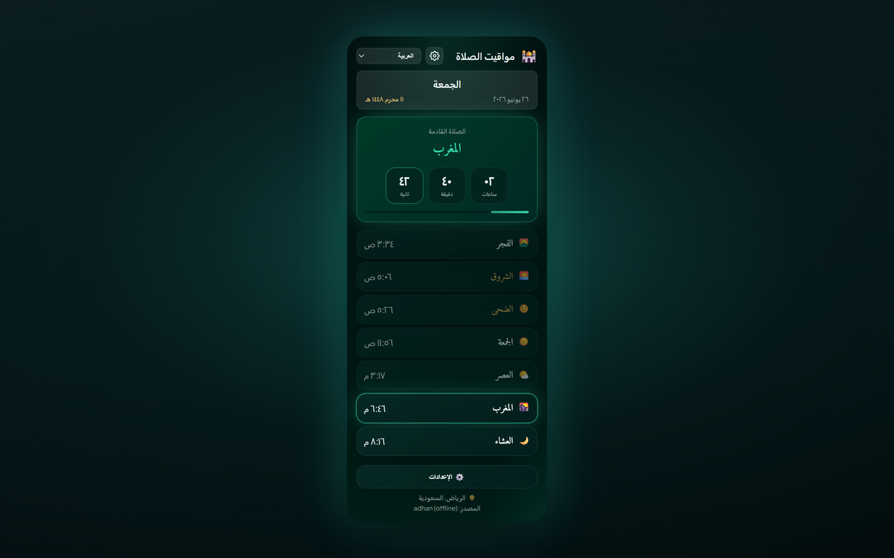
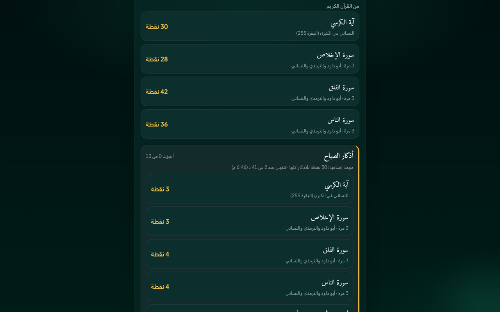

# Prayer Times Reminder — Chrome Extension (العربية)

> **استراحة مواقيت الصلاة** — عند حلول وقت الصلاة، تُقفل تبويباتك المفتوحة لتبتعد عن الشاشة وتؤدّي الصلاة.

إضافة Chrome (Manifest V3) تقوم بـ:

- 🔔 **إرسال إشعار عند حلول وقت كل صلاة** (Fajr, Dhuhr, Asr, Maghrib, Isha) — باللغة التي تختارها.
- 🔒 **قفل اختياري للتبويب** — عند حلول وقت الصلاة، يمنع جميع تبويبات المتصفح المفتوحة لمدة قابلة للضبط (من 1 إلى 120 دقيقة، الافتراضي 5) مع شاشة عدّاد تنازلي؛ كما تُقفل تلقائيًا أي تبويبات تفتحها أو تنتقل إليها أثناء فترة القفل؛ مع إمكانية الفتح يدويًا بالنقر على شاشة القفل. وتحت العدّاد سطر هادئ: «أقبِل على صلاتك بخشوع».
- 🕌 **عرض جدول الصلوات اليومي بالكامل** لمدينتك/بلدك مع عدّاد حي للصلاة التالية.
- 🌍 **قوائم منسدلة للدولة والمدينة** — اختر الدولة وسيتحمّل تلقائيًا قائمة المدن.
- 🌐 **11 لغة** — قم بالتبديل من هيدر الـ popup أو **Settings → Language** (انظر [اللغات المدعومة](#supported-languages)).
- 🌗 **نمط الألوان** — Midnight Emerald (افتراضي) أو Classic — قابل للاختيار من الإعدادات.
- 📅 **تنسيق التاريخ** — اختر طريقة عرض التاريخين الهجري والميلادي معًا (مثل `10-04-2026`, `10 April 2026`, نص طويل).
- 🌙 **التاريخ الهجري** يظهر بجانب التاريخ الميلادي.
- 📿 **ذكر دوري** — تذكير عائم اختياري مع 151 عبارة فريدة على تبويباتك المفتوحة؛ اضغط لإخفائه أو يختفي تلقائيًا بعد 10 ثوانٍ.
- 🎙️ **لعبة أذكار الصلاة (اختيارية)** — تُفتح في تبويب مستقل من «مهمات الأذكار» في إعدادات النافذة المنبثقة: تقرأ أذكار كل صلاة بصوتك، ويتابع التعرّف على الكلام في Chrome قراءتك، وتجمع نقاطًا لكل صلاة ويوم وشهر. تُلعب دون حساب، وتسجيل الدخول بالبريد أو بحساب Google فقط لقائمة المتصدرين ومتابعة الأصدقاء. مواقيت الصلاة لا تحتاج حسابًا أبدًا. وتبدأ قائمة المتصدرين بقوله تعالى: ﴿وَفِي ذَٰلِكَ فَلْيَتَنَافَسِ الْمُتَنَافِسُونَ﴾ [المطففين: 26]، وتُبرز بطاقةُ «آخر الفائزين» 🏆 فائزي كل فترة، مع اسم صاحب المركز الأول ونقاطه باللون الذهبي.
- 🌅 **أذكار الصباح والمساء** — مجموعتان يوميتان في اللعبة بجانب مهمات الصلاة: أذكار الصباح من الفجر حتى المغرب، وأذكار المساء من المغرب حتى الفجر التالي (13 ذكرًا لكل منهما، تُقرأ بالصوت مثل أي مهمة، و50 نقطة إضافية لكل مجموعة كاملة). وقسم اختياري مخفي افتراضيًا يضيف ذكرين «مختلف في تصحيحهما»، تحت كلٍّ منهما مصدره وحكمه، للقراءة فقط ودون نقاط.
- 🔗 **حساب واحد وأكثر من طريقة للدخول** — من «حسابي ‹ طرق تسجيل الدخول» في اللعبة تربط Google بحسابك (وApple متى فُعّل تسجيل الدخول باستخدام Apple)، فتدخل بأيٍّ منهما إلى الحساب نفسه. وعلى أندرويد تظهر علامة ✓ «موثّق» في قائمة المتصدرين بجانب اللاعب الذي يجتاز تطبيقُه فحص Google Play Integrity.
- 🗂️ **التبويب الجديد (اختياري)** — يعرض تبويب كروم الجديد ساعة، والصلاة القادمة بالساعات والدقائق والثواني، ومواقيت اليوم، وبحثًا في الويب، وذكرًا، وتقدّم مهماتك، فوق سماء تتبدّل مع أوقات الصلاة. يمكن إيقافه من «حسابي» في اللعبة، من أي تطبيق.

[English](README.en.md) · [Deutsch](README.de.md) · [العربية](README.ar.md) · [اردو](README.ur.md) · [Français](README.fr.md) · [Español](README.es.md) · [हिन्दी](README.hi.md) · [Bahasa Indonesia](README.id.md)

تُحسب أوقات الصلاة على جهازك دون اتصال عبر [adhan-js](https://github.com/batoulapps/adhan-js) (وتُستخدم واجهة [AlAdhan API](https://aladhan.com/prayer-times-api) المجانية احتياطيًا فقط للمواقع القديمة المحفوظة بلا إحداثيات)؛ وقائمة المدن من [CountriesNow API](https://countriesnow.space) المجانية. لا تتطلب أي مفاتيح API.

## منصات أخرى

- **الموقع** — التطبيق كاملًا في المتصفح: [افتح التطبيق على الويب](https://mphpmaster.github.io/prayer-times-reminder-chrome-ext/app/)
- **أندرويد** — [صفحة التطبيق في Google Play](https://play.google.com/store/apps/details?id=com.mphpmaster.prayer). وأدوات الشاشة الرئيسية (الصلاة القادمة، مواقيت الصلاة، تقدّم الأذكار، العدّاد) تصل مع تحديث أندرويد القادم.
- **ويندوز** — [صفحة التطبيق في متجر مايكروسوفت](https://apps.microsoft.com/detail/9PFTWDWLNL7C)، أو ملف التثبيت من [أحدث إصدار لسطح المكتب](https://github.com/mPhpMaster/prayer-times-reminder-chrome-ext/releases).
- **آيفون / آيباد** — قريبًا، وليس في App Store بعد. يمكنك بناؤه من المصدر، أو تثبيت النسخة المجانية غير الموقّعة جانبيًا: [دليل نسخة iOS](../targets/mobile/IOS.md).
- **ديسكورد** — إضافة لـ Vencord: [خطوات التثبيت](../targets/vencord/README.md).

## التثبيت

**التثبيت من متجر Chrome الإلكتروني (مُستحسن):** [أضِف إلى Chrome](https://chromewebstore.google.com/detail/prayer-times-reminder/knahkbkmbjghaiillhngjbhoinmeegoc)

أو حمّلها غير محزومة لأغراض التطوير:

1. افتح `chrome://extensions` في Chrome.
2. فعّل **Developer mode** (من أعلى اليمين).
3. اضغط **Load unpacked** واختر هذا المجلد.
4. اضغط على أيقونة الإضافة في شريط الأدوات لفتح الـ popup.
5. اضغط **⚙️ Settings**، اختر **Country** ثم **City** من القوائم المنسدلة (أو اضغط **📍 Use my location**)، اختر طريقة الحساب ثم **Save & Load**.
6. اختر اللغة من القائمة المنسدلة داخل هيدر الـ popup (أو من **Settings → Language**).

عند التثبيت لأول مرة، سيتم فتح صفحة ترحيبية تعرض خطوات **تثبيت الإضافة** في شريط أدوات Chrome (Chrome لا يسمح للإضافات بتثبيت نفسها تلقائيًا).

هذا كل شيء — ستقوم الإضافة بحساب أوقات اليوم وعرضها، ثم جدولة إشعار لكل صلاة قادمة. سيتم تحديثها تلقائيًا بعد منتصف الليل لليوم الجديد.

> **الإشعارات:** تأكد من السماح لـ Chrome بعرض الإشعارات النظامية في إعدادات نظام التشغيل؛ وإلا فلن تظهر التنبيهات.

## الإعدادات

في إعدادات النافذة المنبثقة تُجمع هذه الخيارات في أربع بطاقات بهذا الترتيب: **المواقيت** (الدولة والمدينة وطريقة الحساب)، و**التنبيهات والقفل** (قفل التبويب وخياراته)، و**التسبيح والتذكير** (الذكر الدوري)، و**المظهر** (نمط الألوان واللغة وتنسيق التاريخ وشكل الأرقام).

| الإعداد | الوصف |
|---------|-------|
| الدولة / المدينة | الموقع المستخدم لاحتساب أوقات الصلاة (أو استخدام تحديد الموقع). |
| طريقة الحساب | إحدى طرق الحساب المعروفة في AlAdhan، مثل أم القرى ورابطة العالم الإسلامي وISNA والهيئة المصرية وكراتشي والخليج وديانت وJAKIM وKemenag ولجنة رؤية الهلال. |
| قفل التبويب أثناء الصلاة | يحقن طبقة تغطية على كامل الصفحة في جميع التبويبات المفتوحة عند وقت الصلاة. |
| مدة القفل | المدة التي يبقى فيها التبويب مقفولًا (1–120 دقيقة). |
| السماح بالفتح يدويًا | يتيح إنهاء شاشة القفل مبكرًا بالنقر في أي مكان عليها (أو بالضغط على Esc). |
| اختبار قفل التبويب | معاينة طبقة القفل في التبويب الحالي. تعمل في المواقع العادية، لا في صفحات المتصفح الداخلية مثل `chrome://settings` |
| ذكر دوري | يعرض ذكرًا عشوائيًا على تبويباتك المفتوحة ضمن فترة ثابتة أو عشوائية (1–120 دقيقة). |
| موقع الذكر | زاوية أو وسط الصفحة (أعلى/أسفل × يسار/يمين/وسط). |
| اختبار الذكر | معاينة بطاقة الذكر في التبويب الحالي. |
| نمط الألوان | اختر **Midnight Emerald** (افتراضي) أو **Classic**. |
| اللغة | اختر لغة الواجهة (متاحة أيضًا في هيدر الـ popup). |
| تنسيق التاريخ | كيف يظهر التاريخان الهجري والميلادي معًا. |
| شكل الأرقام | عند تفعيل العربية أو الأردو: الأرقام الهندية مثل ٠١٢٣، أو الأرقام الغربية مثل `0123`، للأوقات والعدّاد التنازلي. |

## اللغات المدعومة

يتم ترجمة واجهة المستخدم والإشعارات وطبقة القفل وبطاقة الذكر وصفحة الترحيب. يمكنك تغيير اللغة من قائمة هيدر الـ popup أو من **Settings → Language**.

| الكود | اللغة | الاتجاه | ملاحظات |
|------|--------|---------|---------|
| `en` | English | LTR | القيمة الافتراضية عند غياب نص |
| `de` | Deutsch (German) | LTR | |
| `ar` | العربية (Arabic) | RTL | الافتراضي عند التثبيت الأول، مع خيار الأرقام الهندية مثل ٠١٢٣ |
| `ur` | اردو (Urdu) | RTL | مع خيار الأرقام الهندية مثل ٠١٢٣ |
| `hi` | हिन्दी (Hindi) | LTR | |
| `id` | Bahasa Indonesia | LTR | |
| `fr` | Français (French) | LTR | |
| `es` | Español (Spanish) | LTR | |
| `ru` | Русский (Russian) | LTR | |
| `kk` | Қазақша (Kazakh) | LTR | بالحروف الكيريلية |
| `uz` | Oʻzbekcha (Uzbek) | LTR | بالحروف اللاتينية |

تعيش الترجمات في `i18n.js` (`I18N` + `SUPPORTED_LANGS`). عبارات الذكر في `tasbih-phrases.js` تتضمن العربية مع ترجمة لكل لغة (الهندية تعرض السطر الإنجليزي؛ لا ترجمات هندية بعد).

## الملفات

| الملف | الغرض |
|------|-------|
| `manifest.json` | ملف الإضافة بصيغة MV3. صلاحياته: `alarms` و`notifications` و`storage` و`geolocation` و`scripting` و`offscreen`، وصلاحية اختيارية هي `<all_urls>` |
| `background.js` | خدمة خلفية (Service Worker) — حساب الأوقات، جدولة `chrome.alarms`، إرسال إشعارات مترجمة، وقفل جميع التبويبات المفتوحة عند وقت الصلاة. |
| `overlay-lock.js` | طبقة تغطية محقونة (shadow DOM) تمنع تفاعل الصفحة حتى ينتهي المؤقت أو يقوم المستخدم بفتح القفل يدويًا. |
| `overlay-tasbih.js` | بطاقة ذكر عائمة محقونة؛ تختفي عند الضغط عليها أو بعد 10 ثوانٍ. |
| `tasbih-phrases.js` | 151 عبارة ذكر فريدة. |
| `welcome.html` / `welcome.css` | صفحة الترحيب عند أول تثبيت مع تعليمات التثبيت في شريط الأدوات (مترجمة). |
| `i18n.js` | ترجمات مشتركة (11 لغة)، أسماء الصلوات، قائمة الدول، طرق الحساب، تنسيقات التاريخ، مساعد الأرقام. |
| `popup.html` / `popup.css` / `popup.js` | واجهة الـ popup (الجدول، العدّاد، اختيار اللغة، الإعدادات). |
| `theme.css` | رموز مظهر Midnight Emerald المشتركة (الـ popup والإعدادات وصفحة الترحيب). |
| `icons/` | أيقونات الإضافة (هلال + نجمة). |
| `scripts/make_icons.py` | يعيد توليد أيقونات PNG (للتطوير فقط وليست مطلوبة وقت التشغيل). |
| `PRIVACY.md` | سياسة الخصوصية للإضافة. |
| `TERMS.md` | الشروط والأحكام للإضافة والتطبيقات المرافقة. |

## آلية العمل

- **الجدولة:** عند التثبيت/بدء التشغيل ومع أي تغيير في موقعك، يحسب Service Worker توقيتات اليوم وينشئ إدخالات One-shot لـ `chrome.alarms` عند وقت كل صلاة قادمة، بالإضافة إلى منبه تحديث بعد منتصف الليل.
- **قفل التبويب:** إذا كان مفعلًا في الإعدادات، فعند إطلاق تنبيه الصلاة يقوم امتدادك بحقن `overlay-lock.js` في كل تبويب مفتوح ويعرض عدّادًا تنازليًا لمدة القفل المحددة. طبقة القفل تمنع لوحة المفاتيح والتمرير وإدخال المؤشر على الصفحة. كما تُقفل تلقائيًا أي تبويبات تفتحها أو تنتقل إليها أثناء فترة القفل. فعّل **Allow manual unlock** لإنهائها مبكرًا بالنقر في أي مكان عليها (أو بالضغط على Esc/Enter) — بعد مهلة ثانيتين، حتى لا تُغلقها نقرة كانت جارية قبل أن تراها. استخدم **Test tab lock** في الإعدادات لمعاينتها في التبويب الحالي.
- **تذكير الذكر:** إذا كان مفعلًا، يقوم `chrome.alarms` بعرض عبارة عشوائية من `tasbih-phrases.js` على تبويباتك المفتوحة ضمن فترة ثابتة أو فترة عشوائية ضمن حدّيّ min/max لديك. البطاقة لا تمنع الصفحة؛ اضغط عليها للإخفاء أو انتظر 10 ثوانٍ.
- **الإشعارات:** عند حلول وقت الصلاة، يظهر إشعار نظام مترجم.
- **الـ popup:** يعرض الجدول المحفوظ فورًا ثم يتم تحديثه من الشبكة؛ ويتم تمييز الصلاة التالية مع عدّاد ثانية-بثانية.

## طرق الحساب

القائمة المنسدلة تعرض طرقًا شائعة من AlAdhan — ISNA (أمريكا الشمالية)، رابطة العالم الإسلامي، أم القرى (مكة)، الهيئة المصرية، كراتشي، الخليج، الكويت، قطر، سنغافورة (MUIS)، فرنسا، ديانت (تركيا)، روسيا، دبي، JAKIM (ماليزيا)، Kemenag (إندونيسيا)، المغرب، تونس، الجزائر، الأردن، ولجنة رؤية الهلال العالمية (Moonsighting). اختر ما يناسب مسجدك/جهتك للحصول على أدق الأوقات.

## الخصوصية

راجع [PRIVACY.md](../PRIVACY.md) لمعرفة البيانات التي يتم تخزينها محليًا وما هي واجهات الجهات الخارجية التي يتم الاتصال بها.
وراجع [TERMS.md](../TERMS.md) للشروط التي تنطبق على حساب المواقيت واللعبة الاختيارية وحسابات اللعبة.

## ادعم المشروع

التطبيق مجاني، بلا إعلانات ولا تتبّع. إن أحببت المساعدة في استمراره (واستمرار خادم اللعبة)، يمكنك دعمه عبر [PayPal](https://paypal.me/mfsafadi). جزاك الله خيرًا! وكل الميزات تبقى مجانية في كل الأحوال.

## الترخيص

MIT — راجع [LICENSE](../LICENSE).

---

## هذا التطبيق صدقة جارية عن:
* ام بلال - باشية حجازي
* عبدالله الشرمي
* ام عبدو صراميجو
* أم فجر جونيرتي
* سوهيرمان

وعن جميع المسلمين الأحياء منهم والأموات.

