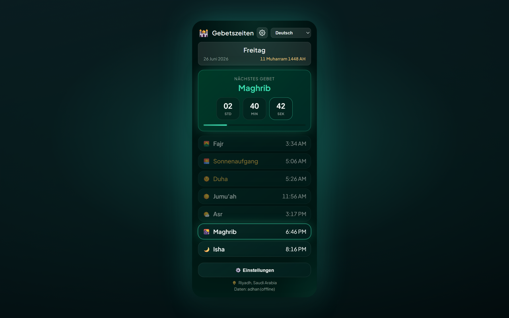

# Prayer Times Reminder — Chrome Extension (Deutsch)

> **Gebetszeiten-Pause** — Wenn die Gebetszeit kommt, werden Ihre offenen Tabs gesperrt, damit Sie innehalten und beten können.

Eine Chrome-Erweiterung (Manifest V3), die:

- 🔔 **Benachrichtigt Sie zu jeder Gebetszeit** (Fajr, Dhuhr, Asr, Maghrib, Isha) — in der von Ihnen gewählten Sprache.
- 🔒 **Optionale Tab-Sperre** — wenn die Gebetszeit erreicht ist, blockiert **ALLE geöffneten Browser-Tabs** für eine einstellbare Dauer (1–120 Minuten, Standard 5) mit einem Countdown-Overlay; Tabs, die Sie während der Sperre öffnen oder zu denen Sie navigieren, werden ebenfalls erfasst; optional manuelles Entsperren durch Antippen des Sperrbildschirms. Unter dem Countdown steht ruhig: „Wenden Sie sich Ihrem Gebet in Demut und Andacht zu“.
- 🕌 **Den vollständigen täglichen Gebetsplan** für Ihre Stadt/Ihr Land anzeigt, mit einem Live-Countdown zum nächsten Gebet.
- 🌍 **Länder- und Stadt-Dropdowns** — wählen Sie ein Land, die Städteliste wird automatisch geladen.
- 🌐 **11 Sprachen** — wechseln Sie über den Popup-Header oder **Settings → Language** (siehe [Unterstützte Sprachen](#unterstützte-sprachen)).
- 🌗 **Design** — Midnight Emerald (Standard) oder Classic — in den Einstellungen wählbar.
- 📅 **Datumsformat** — wählen Sie, wie das Hidschri- und das gregorianische Datum angezeigt werden (z. B. `10-04-2026`, `10 April 2026`, Langtext).
- 🌙 **Hidschri-Datum** wird neben dem gregorianischen Datum angezeigt.
- 📿 **Periodischer Dhikr** — optionaler schwebender Hinweis mit 151 einzigartigen Formulierungen auf Ihren geöffneten Tabs; antippen zum Schließen oder automatisches Ausblenden nach 10 Sekunden.
- 🎙️ **Gebets-Adhkar-Spiel (optional)** — öffnet sich über die Einstellungen des Popups in einem eigenen Tab: Lesen Sie die Adhkar jedes Gebets laut vor, die Spracherkennung von Chrome liest mit, und Sie sammeln Punkte pro Gebet, Tag und Monat. Spielbar ohne Konto; Anmeldung per E-Mail oder Google nur für die Bestenliste und das Folgen von Freunden. Für die Gebetszeiten ist nie ein Konto nötig. Die Bestenliste beginnt mit dem Vers ﴿وَفِي ذَٰلِكَ فَلْيَتَنَافَسِ الْمُتَنَافِسُونَ﴾ (Al-Mutaffifin 83:26), zuerst die Übersetzung der Bedeutung, darunter das Arabische, und hebt die letzten Gewinner jedes Zeitraums hervor, Platz 1 in Gold.
- 🌅 **Morgen- und Abend-Adhkar** — zwei tägliche Zusatz-Sets im Spiel neben den Gebetsaufgaben: die Morgen-Adhkar von Fajr bis Maghrib und die Abend-Adhkar von Maghrib bis zum nächsten Fajr (je 13 Adhkar, laut vorgelesen wie jede Aufgabe, 50 Bonuspunkte pro vollständigem Set). Ein optionaler, standardmäßig ausgeschalteter Abschnitt fügt zwei Adhkar hinzu, deren Authentizität umstritten ist, jeweils mit Quelle und Bewertung, nur zum Lesen und ohne Punkte.
- 🔗 **Ein Konto, mehrere Anmeldemethoden** — im Spiel unter **My account › Sign-in methods** können Sie Google mit Ihrem Konto verknüpfen (und Apple, sobald „Sign in with Apple“ eingeschaltet ist) und sich mit beiden anmelden. Unter Android erhalten Spieler, deren App Google Play Integrity besteht, ein ✓-Verifiziert-Zeichen in der Bestenliste.
- 🗂️ **Neuer Tab (optional)** — der neue Tab von Chrome zeigt eine Uhr, das nächste Gebet in Stunden/Minuten/Sekunden, die heutigen Gebetszeiten, eine Websuche, einen Dhikr und Ihren Adhkar-Fortschritt über einem Himmel, der den Gebetszeiten folgt. Abschalten können Sie ihn über „My account“ im Spiel, in jeder App.

[English](README.en.md) · [Deutsch](README.de.md) · [العربية](README.ar.md) · [اردو](README.ur.md) · [Français](README.fr.md) · [Español](README.es.md) · [हिन्दी](README.hi.md) · [Bahasa Indonesia](README.id.md)

Gebetszeiten werden offline auf Ihrem Gerät mit [adhan-js](https://github.com/batoulapps/adhan-js) berechnet (die kostenlose [AlAdhan API](https://aladhan.com/prayer-times-api) dient nur als Fallback für ältere gespeicherte Orte ohne Koordinaten); die Städteliste von der kostenlosen [CountriesNow API](https://countriesnow.space). Keine API-Schlüssel erforderlich.

## Weitere Plattformen

- **Website** — die ganze App in Ihrem Browser: https://mphpmaster.github.io/prayer-times-reminder-chrome-ext/app/
- **Android** — Google Play: https://play.google.com/store/apps/details?id=com.mphpmaster.prayer — Startbildschirm-Widgets (nächstes Gebet, Gebetszeiten, Adhkar-Fortschritt, Countdown) kommen mit dem nächsten Android-Update.
- **Windows** — Microsoft Store: https://apps.microsoft.com/detail/9PFTWDWLNL7C, oder der Installer aus dem neuesten [Desktop-Release](https://github.com/mPhpMaster/prayer-times-reminder-chrome-ext/releases)
- **iPhone / iPad** — demnächst; noch nicht im App Store. Bauen Sie die App aus dem Quellcode oder installieren Sie den kostenlosen unsignierten Build per Sideloading: [targets/mobile/IOS.md](../targets/mobile/IOS.md)
- **Discord** — ein Vencord-Plugin; Installationsschritte: [targets/vencord/README.md](../targets/vencord/README.md)

## Installation

**Aus dem Chrome Web Store installieren (empfohlen):** [Zu Chrome hinzufügen](https://chromewebstore.google.com/detail/prayer-times-reminder/knahkbkmbjghaiillhngjbhoinmeegoc)

Oder zur Entwicklung als entpackte Erweiterung laden:

1. Öffnen Sie `chrome://extensions` in Chrome.
2. Aktivieren Sie **Developer mode** (oben rechts).
3. Klicken Sie auf **Load unpacked** und wählen Sie diesen Ordner.
4. Klicken Sie auf das Erweiterungssymbol in der Symbolleiste, um das Popup zu öffnen.
5. Klicken Sie auf **⚙️ Settings**, wählen Sie **Country** und dann **City** aus den Dropdowns (oder klicken Sie **📍 Use my location**), wählen Sie eine Berechnungsmethode, dann **Save & Load**.
6. Wählen Sie Ihre Sprache im Dropdown im Popup-Header (oder unter **Settings → Language**).

Bei der Erstinstallation öffnet sich ein Willkommens-Tab mit Schritten zum **Anheften der Erweiterung** an die Chrome-Symbolleiste (Chrome erlaubt Erweiterungen nicht, sich selbst anzuheften).

Das war's — die Erweiterung lädt die heutigen Zeiten, zeigt sie an und plant eine Benachrichtigung für jedes bevorstehende Gebet. Nach Mitternacht wird automatisch für den neuen Tag aktualisiert.

> **Benachrichtigungen:** Stellen Sie sicher, dass Chrome in den OS-Einstellungen Systembenachrichtigungen anzeigen darf, sonst erscheinen die Hinweise nicht.

## Einstellungen

In den Einstellungen des Popups sind diese Optionen in vier Karten gruppiert, in dieser Reihenfolge: **Gebetszeiten** (Land, Stadt, Berechnungsmethode), **Hinweise & Sperre** (die Tab-Sperre und ihre Optionen), **Tasbih & Erinnerungen** (periodischer Dhikr) und **Darstellung** (Theme, Sprache, Datumsformat, Zahlenstil).

| Setting | Description |
|---------|-------------|
| Country / City | Standort für Gebetszeiten (oder Geolokalisierung nutzen). |
| Calculation method | AlAdhan-Methode (ISNA, Muslim World League, Umm al-Qura, Egyptian, Karachi, Gulf, Diyanet, JAKIM, Kemenag, Moonsighting, usw.). |
| Lock tab during prayer | Legt bei Gebetszeit ein Vollbild-Overlay auf alle geöffneten Tabs. |
| Lock duration | Wie lange der Tab gesperrt bleibt (1–120 Minuten). |
| Allow manual unlock | Ermöglicht das vorzeitige Beenden der Sperre durch Antippen an beliebiger Stelle (oder mit Esc). |
| Test tab lock | Vorschau des Sperr-Overlays auf dem aktuellen Tab (funktioniert auf normalen Websites, nicht auf `chrome://`-Seiten). |
| Periodic dhikr | Zeigt einen zufälligen Dhikr auf Ihren geöffneten Tabs in festem oder zufälligem Intervall (1–120 Minuten). |
| Dhikr position | Ecke oder Mitte der Seite (oben/unten × links/rechts/Mitte). |
| Test dhikr | Vorschau der Dhikr-Karte auf dem aktuellen Tab. |
| Theme | **Midnight Emerald** (Standard) oder **Classic** wählen. |
| Language | UI-Sprache wählen (auch im Popup-Header verfügbar). |
| Date format | Wie das Hidschri- und das gregorianische Datum erscheinen. |
| Number style | Wenn Arabisch oder Urdu aktiv: Arabic-Indic (٠١٢٣) oder westliche (0123) Ziffern für Zeiten und Countdowns. |

## Unterstützte Sprachen

UI, Benachrichtigungen, Sperr-Overlay, Dhikr-Karte und Willkommensseite sind lokalisiert. Sprache wechseln über das Dropdown im Popup-Header oder **Settings → Language**.

| Code | Language | Direction | Notes |
|------|----------|-----------|-------|
| `en` | English | LTR | Standard-Fallback bei fehlenden Texten |
| `de` | Deutsch (German) | LTR | |
| `ar` | العربية (Arabic) | RTL | Standard bei Erstinstallation; optionale Arabic-Indic-Ziffern (٠١٢٣) |
| `ur` | اردو (Urdu) | RTL | Optionale Arabic-Indic-Ziffern (٠١٢٣) |
| `hi` | हिन्दी (Hindi) | LTR | |
| `id` | Bahasa Indonesia | LTR | |
| `fr` | Français (French) | LTR | |
| `es` | Español (Spanish) | LTR | |
| `ru` | Русский (Russian) | LTR | |
| `kk` | Қазақша (Kazakh) | LTR | Kyrillische Schrift |
| `uz` | Oʻzbekcha (Uzbek) | LTR | Lateinische Schrift |

Übersetzungen befinden sich in `i18n.js` (`I18N` + `SUPPORTED_LANGS`). Dhikr-Formulierungen in `tasbih-phrases.js` enthalten Arabisch mit einer Übersetzung pro Sprache (Hindi zeigt die englische Zeile; noch keine Hindi-Übersetzungen).

## Dateien

| File | Purpose |
|------|---------|
| `manifest.json` | MV3-Manifest (Berechtigungen: alarms, notifications, storage, geolocation, scripting, offscreen; optional `<all_urls>`). |
| `background.js` | Service Worker — berechnet die Zeiten, plant `chrome.alarms`, sendet lokalisierte Benachrichtigungen, sperrt alle geöffneten Tabs zur Gebetszeit. |
| `overlay-lock.js` | Injected Overlay (Shadow DOM), das Seiteninteraktion blockiert, bis der Timer endet oder Sie manuell entsperren. |
| `overlay-tasbih.js` | Injected schwebende Dhikr-Karte; schließen per Tippen oder nach 10 Sekunden. |
| `tasbih-phrases.js` | 151 einzigartige Dhikr-Formulierungen. |
| `welcome.html` / `welcome.css` | Willkommensseite bei Erstinstallation mit Anheft-Anleitung (lokalisiert). |
| `i18n.js` | Gemeinsame Übersetzungen (11 Sprachen), Gebetsnamen, Länderliste, Berechnungsmethoden, Datumsformate, Ziffern-Helfer. |
| `popup.html` / `popup.css` / `popup.js` | Popup-Oberfläche (Plan, Countdown, Sprachauswahl, Einstellungen). |
| `theme.css` | Gemeinsame Midnight-Emerald-Design-Tokens und Utilities (Popup, Einstellungen, Willkommen). |
| `icons/` | Erweiterungssymbole (Halbmond + Stern). |
| `scripts/make_icons.py` | Erzeugt die PNG-Symbole neu (nur für Entwicklung, zur Laufzeit nicht nötig). |
| `PRIVACY.md` | Datenschutzrichtlinie der Erweiterung. |
| `TERMS.md` | Nutzungsbedingungen für die Erweiterung und die Begleit-Apps. |

## Funktionsweise

- **Planung:** Bei Installation/Start und bei Standortänderung berechnet der Service Worker die heutigen Zeiten und erstellt einmalige `chrome.alarms`-Einträge zu jeder bevorstehenden Gebetszeit, plus einen Refresh-Alarm kurz nach Mitternacht.
- **Tab-Sperre:** Wenn in den Einstellungen aktiviert, injiziert die Erweiterung bei einem Gebetsalarm `overlay-lock.js` in jeden geöffneten Tab und zeigt ein Countdown-Overlay für die konfigurierte Dauer. Das Overlay blockiert Tastatur, Scrollen und Zeigereingaben. Tabs, die Sie während des Sperrzeitfensters öffnen oder zu denen Sie navigieren, werden ebenfalls automatisch gesperrt. Aktivieren Sie **Allow manual unlock**, um die Sperre durch Antippen an beliebiger Stelle (oder mit Esc/Enter) vorzeitig zu beenden — nach einer Schonfrist von 2 Sekunden, damit ein laufender Klick sie nicht ungesehen schließt. Nutzen Sie **Test tab lock** für eine Vorschau auf dem aktuellen Tab.
- **Dhikr-Erinnerung:** Wenn aktiviert, zeigt ein `chrome.alarms`-Timer in festem oder zufälligem Intervall (min/max) eine zufällige Formulierung aus `tasbih-phrases.js` auf Ihren geöffneten Tabs. Die Karte blockiert die Seite nicht; tippen zum Schließen oder 10 Sekunden warten.
- **Benachrichtigungen:** Wenn eine Gebetszeit erreicht ist, erscheint eine lokalisierte Systembenachrichtigung.
- **Popup:** Zeigt den gecachten Plan sofort und aktualisiert dann aus dem Netzwerk; das nächste Gebet wird mit sekündlichem Countdown hervorgehoben.

## Berechnungsmethoden

Das Einstellungs-Dropdown bietet gängige AlAdhan-Methoden — ISNA (Nordamerika), Muslim World League, Umm al-Qura (Mekka), Egyptian, Karachi, Gulf, Kuwait, Qatar, Singapore (MUIS), France, Diyanet (Türkei), Russia, Dubai, JAKIM (Malaysia), Kemenag (Indonesien), Morocco, Tunisia, Algeria, Jordan und Moonsighting Committee Worldwide. Wählen Sie die Methode Ihrer lokalen Moschee/Autorität für die genauesten Zeiten.

## Datenschutz

Siehe [PRIVACY.md](../PRIVACY.md) für lokal gespeicherte Daten und kontaktierte Drittanbieter-APIs.
Siehe [TERMS.md](../TERMS.md) für die Bedingungen, die für Gebetszeitberechnungen, das optionale Spiel und Spielkonten gelten.

## Projekt unterstützen

Die App ist kostenlos, ohne Werbung und ohne Tracking. Wenn Sie helfen möchten, sie (und ihren Spielserver) am Laufen zu halten, können Sie sie über [PayPal](https://paypal.me/mfsafadi) unterstützen. Vielen Dank! Alle Funktionen bleiben so oder so kostenlos.

## Lizenz

MIT — siehe [LICENSE](../LICENSE).

---

## Laufende Spende (Sadaqah Jariyah) im Namen von:
* Om Bilal - Bashia Hegazi
* Abdullah Al-Shami
* Om Abdo Sramijo
* Om Fajr Junirti
* Suherman

Und im Namen aller Muslime, sowohl der Lebenden als auch der Verstorbenen.

