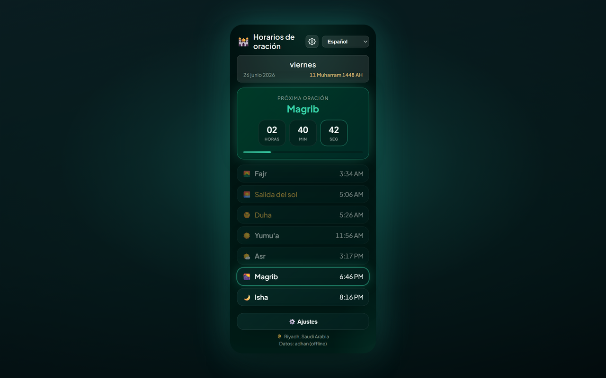

# Prayer Times Reminder — Chrome Extension (Español)

> **Pausa de horarios de oración** — cuando llega la hora de la oración, tus pestañas abiertas se bloquean para que puedas apartarte y orar.

Una extensión de Chrome (Manifest V3) que:

- 🔔 **Te notifica a la hora de cada oración** (Fajr, Dhuhr, Asr, Maghrib, Isha) — en el idioma que hayas elegido.
- 🔒 **Bloqueo opcional de pestañas** — cuando llega la hora, bloquea **TODAS las pestañas abiertas del navegador** durante una duración configurable (1–120 minutos, por defecto 5) con una cuenta atrás; las pestañas que abras o a las que navegues durante el bloqueo también quedan cubiertas; opción de desbloqueo manual tocando la pantalla de bloqueo.
- 🕌 **Muestra el horario diario completo** para tu ciudad/país, con una cuenta atrás en tiempo real hacia la siguiente oración.
- 🌍 **Menús desplegables de país y ciudad** — elige un país y la lista de ciudades se cargará automáticamente.
- 🌐 **11 idiomas** — cambia desde el encabezado del popup o **Settings → Language** (ver [Supported languages](#supported-languages)).
- 🌗 **Tema** — Midnight Emerald (por defecto) o Classic — seleccionable en Configuración.
- 📅 **Formato de fecha** — elige cómo se muestran las fechas Hijri y gregoriana (por ejemplo `10-04-2026`, `10 April 2026`, texto largo).
- 🌙 **Fecha Hijri** mostrada junto con la fecha gregoriana.
- 📿 **Dhikr periódico** — recordatorio flotante opcional con 151 frases únicas en tus pestañas abiertas; tócalo para cerrar o se ocultará automáticamente después de 10 segundos.
- 🎙️ **Juego de adhkar de la oración (opcional)** — se abre en su propia pestaña desde la Configuración del popup: lee en voz alta los adhkar de cada oración, el reconocimiento de voz de Chrome te sigue y ganas puntos por oración, día y mes. Se juega sin cuenta; el inicio de sesión con correo o Google solo es necesario para la clasificación y para seguir a amigos. Los horarios de oración nunca requieren una cuenta.
- 🌅 **Adhkar de la mañana y de la tarde** — dos series diarias adicionales en el juego, junto a las tareas de oración: los adhkar de la mañana desde Fajr hasta Maghrib y los adhkar de la tarde desde Maghrib hasta el siguiente Fajr (13 adhkar cada una, leídos en voz alta como cualquier tarea, 50 puntos extra por serie completa). Una sección opcional, desactivada por defecto, añade dos adhkar cuya autenticidad es discutida, cada uno con su fuente y su calificación, solo para lectura y sin puntos.
- 🔗 **Una cuenta, varios métodos de inicio de sesión** — en **My account › Sign-in methods** dentro del juego puedes vincular Google a tu cuenta (y Apple, cuando se active Sign in with Apple) e iniciar sesión con cualquiera de ellos. En Android, los jugadores cuya app supera Google Play Integrity reciben una marca ✓ de verificado en la clasificación.
- 🗂️ **Nueva pestaña (opcional)** — la nueva pestaña de Chrome muestra un reloj, la siguiente oración en horas/minutos/segundos, los horarios de oración de hoy, una búsqueda web, un dhikr y tu progreso de adhkar, sobre un cielo que sigue los horarios de oración. Desactívala desde “My account” en el juego, en cualquier app.

[English](README.en.md) · [Deutsch](README.de.md) · [العربية](README.ar.md) · [اردو](README.ur.md) · [Français](README.fr.md) · [Español](README.es.md) · [हिन्दी](README.hi.md) · [Bahasa Indonesia](README.id.md)

Los horarios de oración se calculan sin conexión en tu dispositivo con [adhan-js](https://github.com/batoulapps/adhan-js) (la API gratuita [AlAdhan API](https://aladhan.com/prayer-times-api) solo se usa como respaldo para ubicaciones antiguas guardadas sin coordenadas); la lista de ciudades proviene de la API gratuita [CountriesNow API](https://countriesnow.space). No se requieren claves API.

## Otras plataformas

- **Sitio web** — toda la app en tu navegador: https://mphpmaster.github.io/prayer-times-reminder-chrome-ext/app/
- **Android** — Google Play: https://play.google.com/store/apps/details?id=com.mphpmaster.prayer — los widgets de pantalla de inicio (siguiente oración, horarios de oración, progreso de adhkar, cuenta atrás) llegarán con la próxima actualización de Android.
- **Windows** — Microsoft Store: https://apps.microsoft.com/detail/9PFTWDWLNL7C, o el instalador de la [versión de escritorio](https://github.com/mPhpMaster/prayer-times-reminder-chrome-ext/releases) más reciente
- **iPhone / iPad** — próximamente; todavía no está en el App Store. Compílala desde el código fuente o instala por sideload la compilación gratuita sin firmar: [targets/mobile/IOS.md](../targets/mobile/IOS.md)
- **Discord** — un plugin de Vencord; pasos de instalación: [targets/vencord/README.md](../targets/vencord/README.md)

## Instalación

**Instalar desde la Chrome Web Store (recomendado):** [Añadir a Chrome](https://chromewebstore.google.com/detail/prayer-times-reminder/knahkbkmbjghaiillhngjbhoinmeegoc)

O cárgala sin empaquetar para desarrollo:

1. Abre `chrome://extensions` en Chrome.
2. Activa **Developer mode** (arriba a la derecha).
3. Haz clic en **Load unpacked** y selecciona esta carpeta.
4. Haz clic en el icono de la extensión en la barra de herramientas para abrir el popup.
5. Haz clic en **⚙️ Settings**, elige tu **Country** y luego **City** en los desplegables (o haz clic en **📍 Use my location**), elige un método de cálculo y luego **Save & Load**.
6. Elige tu idioma desde el desplegable del encabezado del popup (o en **Settings → Language**).

Al instalar por primera vez, se abre una pestaña de bienvenida con pasos para **fijar la extensión** en la barra de herramientas de Chrome (Chrome no permite que las extensiones se fijen automáticamente).

Listo — la extensión obtendrá los horarios de hoy, los mostrará y programará una notificación para cada oración próxima. Se actualiza automáticamente después de medianoche para el día nuevo.

> **Notificaciones:** asegúrate de que Chrome tenga permiso para mostrar notificaciones del sistema en la configuración de tu sistema operativo; de lo contrario, no aparecerán las alertas.

## Configuración

| Setting | Description |
|---------|-------------|
| Country / City | Ubicación usada para los horarios de oración (o usa geolocalización). |
| Calculation method | Método AlAdhan (ISNA, Muslim World League, Umm al-Qura, Egyptian, Karachi, Gulf, Diyanet, JAKIM, Kemenag, Moonsighting, etc.). |
| Date format | Cómo aparecen las fechas Hijri y gregoriana. |
| Number style | Cuando están activos árabe o urdu: dígitos Arabic-Indic (٠١٢٣) o Western (0123) para horarios y cuenta atrás. |
| Lock tab during prayer | Inyecta una capa de página completa en todas las pestañas abiertas en la hora de la oración. |
| Lock duration | Cuánto tiempo permanece bloqueada la pestaña (1–120 minutos). |
| Allow manual unlock | Permite quitar la pantalla de bloqueo antes tocándola en cualquier lugar (o pulsando Esc). |
| Test tab lock | Vista previa de la capa de bloqueo en la pestaña actual (funciona en sitios normales, no en páginas `chrome://`). |
| Periodic dhikr | Muestra un dhikr aleatorio en tus pestañas abiertas a un intervalo fijo o aleatorio (1–120 minutos). |
| Dhikr position | Esquina o centro de la página (arriba/abajo × izquierda/derecha/centro). |
| Test dhikr | Vista previa de la tarjeta de dhikr en la pestaña actual. |
| Theme | Elige **Midnight Emerald** (por defecto) o **Classic**. |
| Language | Elige el idioma de la interfaz (también disponible en el encabezado del popup). |

## Idiomas admitidos

La interfaz de usuario, las notificaciones, la capa de bloqueo, la tarjeta de dhikr y la página de bienvenida están localizadas. Cambia el idioma desde el desplegable del encabezado del popup o **Settings → Language**.

| Code | Language | Direction | Notes |
|------|----------|-----------|-------|
| `en` | English | LTR | Reemplazo por defecto si falta una cadena |
| `de` | Deutsch (German) | LTR | |
| `ar` | العربية (Arabic) | RTL | Predeterminado en la primera instalación; numerales Arabic-Indic opcionales (٠١٢٣) |
| `ur` | اردو (Urdu) | RTL | Numerales Arabic-Indic opcionales (٠١٢٣) |
| `hi` | हिन्दी (Hindi) | LTR | |
| `id` | Bahasa Indonesia | LTR | |
| `fr` | Français (French) | LTR | |
| `es` | Español (Spanish) | LTR | |
| `ru` | Русский (Russian) | LTR | |
| `kk` | Қазақша (Kazakh) | LTR | Alfabeto cirílico |
| `uz` | Oʻzbekcha (Uzbek) | LTR | Alfabeto latino |

Las traducciones viven en `i18n.js` (`I18N` + `SUPPORTED_LANGS`). Las frases de dhikr en `tasbih-phrases.js` incluyen el árabe con una traducción por idioma (el hindi muestra la línea en inglés; aún no hay traducciones al hindi).

## Archivos

| File | Purpose |
|------|---------|
| `manifest.json` | Manifest MV3 (permissions: alarms, notifications, storage, geolocation, scripting, offscreen; `<all_urls>` opcional). |
| `background.js` | Service worker — calcula los horarios, agenda `chrome.alarms`, muestra notificaciones localizadas y bloquea todas las pestañas abiertas en la hora de oración. |
| `overlay-lock.js` | Capa inyectada (shadow DOM) que bloquea la interacción con la página hasta que termine el temporizador o el usuario desbloquee manualmente. |
| `overlay-tasbih.js` | Tarjeta flotante de dhikr inyectada; se descarta al tocarla o después de 10 segundos. |
| `tasbih-phrases.js` | 151 frases únicas de dhikr. |
| `welcome.html` / `welcome.css` | Página de bienvenida al instalar (instrucciones para fijar en la barra) (localizada). |
| `i18n.js` | Traducciones compartidas (11 idiomas), nombres de oraciones, lista de países, métodos de cálculo, formatos de fecha y ayuda de dígitos. |
| `popup.html` / `popup.css` / `popup.js` | UI del popup (horarios, cuenta atrás, selector de idioma y configuración). |
| `theme.css` | Tokens y utilidades compartidos del tema Midnight Emerald (popup, configuración, bienvenida). |
| `icons/` | Iconos de la extensión (luna creciente + estrella). |
| `scripts/make_icons.py` | Regenera los iconos PNG (solo dev; no es necesario en runtime). |
| `PRIVACY.md` | Política de privacidad de la extensión. |
| `TERMS.md` | Términos y condiciones de la extensión y de las apps complementarias. |

## Cómo funciona

- **Programación:** en instalación/inicio y cada vez que cambia tu ubicación, el service worker calcula los horarios del día y crea entradas one-shot de `chrome.alarms` en el momento exacto de cada oración próxima, además de un alarm de actualización justo después de medianoche.
- **Bloqueo de pestañas:** si está activado en Configuración, cuando suena una alarma de oración la extensión inyecta `overlay-lock.js` en todas las pestañas abiertas y muestra una cuenta atrás durante la duración configurada. La capa bloquea teclado, desplazamiento y la entrada del puntero. Las pestañas que abras o a las que navegues durante el periodo de bloqueo también se bloquean automáticamente. Activa **Allow manual unlock** para quitarla antes tocándola en cualquier lugar (o pulsando Esc/Enter) — tras un margen de 2 segundos, para que un clic ya en curso no la cierre sin que la veas. Usa **Test tab lock** en Configuración para previsualizar en la pestaña actual.
- **Recordatorio de dhikr:** si está activado, un temporizador `chrome.alarms` muestra una frase aleatoria de `tasbih-phrases.js` en tus pestañas abiertas en un intervalo fijo o aleatorio dentro del rango min/max. La tarjeta no bloquea la página; haz clic para descartar o espera 10 segundos.
- **Notificaciones:** cuando llega la hora de una oración, aparece una notificación del sistema localizada.
- **Popup:** renderiza el horario en caché al instante y luego se refresca desde la red; la siguiente oración se resalta con una cuenta atrás segundo a segundo.

## Métodos de cálculo

El menú desplegable de Configuración muestra métodos comunes de AlAdhan — ISNA (Norteamérica), Muslim World League, Umm al-Qura (La Meca), Egyptian, Karachi, Gulf, Kuwait, Qatar, Singapore (MUIS), France, Diyanet (Turquía), Russia, Dubai, JAKIM (Malasia), Kemenag (Indonesia), Morocco, Tunisia, Algeria, Jordan y Moonsighting Committee Worldwide. Elige el que mejor coincida con tu mezquita/autoridad para obtener los horarios más precisos.

## Privacidad

Consulta [PRIVACY.md](../PRIVACY.md) para saber qué datos se almacenan localmente y a qué APIs de terceros se accede.
Consulta [TERMS.md](../TERMS.md) para conocer los términos que se aplican a los cálculos de horarios de oración, al juego opcional y a las cuentas del juego.

## Apoya el proyecto

La app es gratuita, sin anuncios y sin rastreo. Si quieres ayudar a mantenerla (y su servidor del juego) en funcionamiento, puedes apoyarla en [PayPal](https://paypal.me/mfsafadi). ¡Gracias! Todas las funciones siguen siendo gratuitas en cualquier caso.

## Licencia

MIT — ver [LICENSE](../LICENSE).

---

## Caridad Continua (Sadaqah Jariyah) en nombre de:
* Om Bilal - Bashia Hegazi
* Abdullah Al-Shami
* Om Abdo Sramijo
* Om Fajr Junirti
* Suherman

Y en nombre de todos los musulmanes, tanto los vivos como los fallecidos.

