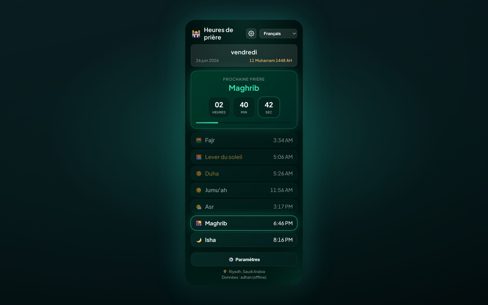

# Prayer Times Reminder — Chrome Extension (Français)

> **Pause des heures de prière** — à l'heure de la prière, vos onglets ouverts se verrouillent pour vous permettre de vous éloigner et de prier.

Une extension Chrome (Manifest V3) qui :

- 🔔 **Vous notifie à l’heure de chaque prière** (Fajr, Dhuhr, Asr, Maghrib, Isha) — dans la langue que vous choisissez.
- 🔒 **Verrouillage optionnel des onglets** — à l’heure de la prière, bloque **tous les onglets de navigateur ouverts** pendant une durée configurable (1–120 minutes, par défaut 5) avec un compte à rebours ; les onglets que vous ouvrez ou vers lesquels vous naviguez pendant le verrouillage sont également couverts ; option de déverrouillage manuel en touchant l’écran de verrouillage. Sous le compte à rebours, une ligne apaisante : « Tournez-vous vers votre prière avec humilité et recueillement ».
- 🕌 **Affiche le programme complet des prières** pour votre ville/pays, avec un compte à rebours en temps réel vers la prochaine prière.
- 🌍 **Sélecteurs pays & ville** — choisissez un pays, et la liste des villes se charge automatiquement.
- 🌐 **11 langues** — basculez depuis le menu du popup ou **Settings → Language** (voir [Supported languages](#supported-languages)).
- 🌗 **Thème** — Midnight Emerald (par défaut) ou Classic — sélectionnable dans les paramètres.
- 📅 **Format de date** — choisissez comment les dates Hijri et grégorienne sont affichées (par ex. `10-04-2026`, `10 April 2026`, texte long).
- 🌙 **Date Hijri** affichée à côté de la date grégorienne.
- 📿 **Dhikr périodique** — rappel flottant optionnel avec 151 phrases uniques sur vos onglets ouverts ; cliquez pour fermer ou masquez automatiquement après 10 secondes.
- 🎙️ **Jeu des adhkar de la prière (optionnel)** — s’ouvre dans son propre onglet depuis les paramètres du popup : lisez à voix haute les adhkar de chaque prière, la reconnaissance vocale de Chrome suit votre lecture, et vous gagnez des points par prière, par jour et par mois. Il se joue sans compte ; la connexion par e-mail ou Google ne sert qu’au classement et au suivi d’amis. Les heures de prière ne demandent jamais de compte. Le classement s’ouvre sur le verset ﴿وَفِي ذَٰلِكَ فَلْيَتَنَافَسِ الْمُتَنَافِسُونَ﴾ (Al-Mutaffifin 83:26), la traduction du sens d’abord et l’arabe dessous, et met en avant les derniers gagnants de chaque période, la première place en or.
- 🌅 **Adhkar du matin et du soir** — deux séries quotidiennes annexes dans le jeu, à côté des tâches de prière : les adhkar du matin de Fajr jusqu’à Maghrib et les adhkar du soir de Maghrib jusqu’au Fajr suivant (13 adhkar chacune, lus à voix haute comme toute tâche, 50 points bonus par série complète). Une section optionnelle, désactivée par défaut, ajoute deux adhkar dont l’authenticité est discutée, chacun avec sa source et son degré d’authenticité, pour la lecture seulement et sans points.
- 🔗 **Un compte, plusieurs méthodes de connexion** — dans le jeu, sous **My account › Sign-in methods**, vous pouvez lier Google à votre compte (et Apple, une fois Sign in with Apple activé) et vous connecter avec l’un ou l’autre. Sur Android, les joueurs dont l’application passe Google Play Integrity reçoivent une marque ✓ vérifié dans le classement.
- 🗂️ **Nouvel onglet (optionnel)** — le nouvel onglet de Chrome affiche une horloge, la prochaine prière en heures/minutes/secondes, les heures de prière du jour, une recherche web, un dhikr et votre progression des adhkar, sur un ciel qui suit les heures de prière. Désactivez-le depuis « My account » dans le jeu, dans n’importe quelle application.

[English](README.en.md) · [Deutsch](README.de.md) · [العربية](README.ar.md) · [اردو](README.ur.md) · [Français](README.fr.md) · [Español](README.es.md) · [हिन्दी](README.hi.md) · [Bahasa Indonesia](README.id.md)

Les heures de prière sont calculées hors ligne sur votre appareil avec [adhan-js](https://github.com/batoulapps/adhan-js) (l’API gratuite [AlAdhan API](https://aladhan.com/prayer-times-api) ne sert que de secours pour les anciens emplacements enregistrés sans coordonnées) ; la liste des villes provient de l’API gratuite [CountriesNow API](https://countriesnow.space). Aucune clé API requise.

## Autres plateformes

- **Site web** — toute l’application dans votre navigateur : https://mphpmaster.github.io/prayer-times-reminder-chrome-ext/app/
- **Android** — Google Play : https://play.google.com/store/apps/details?id=com.mphpmaster.prayer — les widgets d’écran d’accueil (prochaine prière, heures de prière, progression des adhkar, compte à rebours) arrivent avec la prochaine mise à jour Android.
- **Windows** — Microsoft Store : https://apps.microsoft.com/detail/9PFTWDWLNL7C, ou l’installateur de la [version desktop](https://github.com/mPhpMaster/prayer-times-reminder-chrome-ext/releases) la plus récente
- **iPhone / iPad** — bientôt disponible ; pas encore sur l’App Store. Compilez-la depuis les sources, ou installez par sideload la version gratuite non signée : [targets/mobile/IOS.md](../targets/mobile/IOS.md)
- **Discord** — un plugin Vencord ; étapes d’installation : [targets/vencord/README.md](../targets/vencord/README.md)

## Installation

**Installer depuis le Chrome Web Store (recommandé) :** [Ajouter à Chrome](https://chromewebstore.google.com/detail/prayer-times-reminder/knahkbkmbjghaiillhngjbhoinmeegoc)

Ou chargez-la non empaquetée pour le développement :

1. Ouvrez `chrome://extensions` dans Chrome.
2. Activez **Developer mode** (en haut à droite).
3. Cliquez sur **Load unpacked** et sélectionnez ce dossier.
4. Cliquez sur l’icône de l’extension dans la barre d’outils pour ouvrir le popup.
5. Cliquez sur **⚙️ Settings**, choisissez **Country** puis **City** dans les menus déroulants (ou cliquez **📍 Use my location**), choisissez une méthode de calcul, puis **Save & Load**.
6. Choisissez votre langue dans le menu déroulant du popup (ou dans **Settings → Language**).

Lors de la première installation, un onglet de bienvenue s’ouvre avec des étapes pour **épingler l’extension** à la barre d’outils de Chrome (Chrome ne permet pas aux extensions de s’épingler automatiquement).

C’est tout — l’extension récupère les horaires d’aujourd’hui, les affiche, et planifie une notification pour chaque prière à venir. Elle se rafraîchit automatiquement après minuit pour le nouveau jour.

> **Notifications :** assurez-vous que Chrome est autorisé à afficher les notifications système dans les paramètres de votre OS, sinon les alertes n’apparaîtront pas.

## Paramètres

Dans les paramètres du popup, ces options sont regroupées en quatre cartes, dans cet ordre : **Horaires de prière** (pays, ville, méthode de calcul), **Alertes et verrouillage** (le verrouillage des onglets et ses options), **Tasbih et rappels** (dhikr périodique) et **Apparence** (thème, langue, format de date, style des chiffres).

| Setting | Description |
|---------|-------------|
| Country / City | Lieu utilisé pour les heures de prière (ou utilisez la géolocalisation). |
| Calculation method | Méthode AlAdhan (ISNA, Muslim World League, Umm al-Qura, Egyptian, Karachi, Gulf, Diyanet, JAKIM, Kemenag, Moonsighting, etc.). |
| Lock tab during prayer | Injecte un overlay plein écran sur tous les onglets ouverts à l’heure de prière. |
| Lock duration | Durée pendant laquelle l’onglet reste verrouillé (1–120 minutes). |
| Allow manual unlock | Permet de fermer l’écran de verrouillage plus tôt en le touchant n’importe où (ou avec Échap). |
| Test tab lock | Aperçu de l’overlay de verrouillage sur l’onglet actuel (fonctionne sur des sites normaux, pas sur les pages `chrome://`). |
| Periodic dhikr | Affiche un dhikr aléatoire sur vos onglets ouverts à intervalle fixe ou aléatoire (1–120 minutes). |
| Dhikr position | Coin ou centre de la page (haut/bas × gauche/droite/centre). |
| Test dhikr | Aperçu de la carte dhikr sur l’onglet actuel. |
| Theme | Choisissez **Midnight Emerald** (par défaut) ou **Classic**. |
| Language | Choisissez la langue de l’interface (disponible aussi dans le popup). |
| Date format | Comment les dates Hijri et grégorienne apparaissent. |
| Number style | Quand l’arabe ou l’ourdou est actif : chiffres Arabic-Indic (٠١٢٣) ou occidentaux (0123) pour les horaires et le compte à rebours. |

## Langues prises en charge

L’interface, les notifications, l’overlay de verrouillage, la carte dhikr et la page de bienvenue sont localisés. Changez de langue depuis le menu du popup ou **Settings → Language**.

| Code | Language | Direction | Notes |
|------|----------|-----------|-------|
| `en` | English | LTR | Repli par défaut si une chaîne manque |
| `de` | Deutsch (German) | LTR | |
| `ar` | العربية (Arabic) | RTL | Par défaut à la première installation ; chiffres Arabic-Indic en option (٠١٢٣) |
| `ur` | اردو (Urdu) | RTL | Chiffres Arabic-Indic en option (٠١٢٣) |
| `hi` | हिन्दी (Hindi) | LTR | |
| `id` | Bahasa Indonesia | LTR | |
| `fr` | Français (French) | LTR | |
| `es` | Español (Spanish) | LTR | |
| `ru` | Русский (Russian) | LTR | |
| `kk` | Қазақша (Kazakh) | LTR | Alphabet cyrillique |
| `uz` | Oʻzbekcha (Uzbek) | LTR | Alphabet latin |

Les traductions vivent dans `i18n.js` (`I18N` + `SUPPORTED_LANGS`). Les phrases de dhikr dans `tasbih-phrases.js` incluent l’arabe avec une traduction par langue (le hindi affiche la ligne anglaise ; pas encore de traductions en hindi).

## Fichiers

| File | Purpose |
|------|---------|
| `manifest.json` | Manifest MV3 (permissions : alarms, notifications, storage, geolocation, scripting, offscreen ; `<all_urls>` optionnel). |
| `background.js` | Service worker — calcule les horaires, planifie `chrome.alarms`, envoie des notifications localisées, et verrouille tous les onglets ouverts à l’heure de prière. |
| `overlay-lock.js` | Overlay injecté (shadow DOM) qui bloque l’interaction de la page jusqu’à la fin du minuteur ou le déverrouillage manuel. |
| `overlay-tasbih.js` | Carte dhikr flottante injectée ; disparaît au clic ou après 10 secondes. |
| `tasbih-phrases.js` | 151 phrases dhikr uniques. |
| `welcome.html` / `welcome.css` | Page de bienvenue lors de la première installation avec instructions d’épinglage (localisées). |
| `i18n.js` | Traductions partagées (11 langues), noms des prières, liste des pays, méthodes de calcul, formats de date, aide pour les chiffres. |
| `popup.html` / `popup.css` / `popup.js` | L’interface du popup (programme, compte à rebours, sélecteur de langue, paramètres). |
| `theme.css` | Jetons et utilitaires partagés du thème Midnight Emerald (popup, paramètres, bienvenue). |
| `icons/` | Icônes de l’extension (croissant + étoile). |
| `scripts/make_icons.py` | Reconstruit les icônes PNG (dev-only, pas nécessaire à l’exécution). |
| `PRIVACY.md` | Politique de confidentialité pour l’extension. |
| `TERMS.md` | Conditions générales de l’extension et des applications compagnons. |

## Fonctionnement

- **Planification :** à l’installation/démarrage et à chaque changement de localisation, le service worker calcule les horaires du jour et crée des entrées `chrome.alarms` one-shot à l’heure de chaque prière à venir, plus une alarme de rafraîchissement juste après minuit.
- **Verrouillage des onglets :** si activé dans les paramètres, quand une alarme de prière se déclenche l’extension injecte `overlay-lock.js` dans tous les onglets ouverts et affiche un compte à rebours pour la durée configurée. L’overlay bloque le clavier, le défilement et l’entrée du pointeur. Les onglets que vous ouvrez ou vers lesquels vous naviguez pendant la fenêtre de verrouillage sont également verrouillés automatiquement. Activez **Allow manual unlock** pour le fermer plus tôt en le touchant n’importe où (ou avec Échap/Entrée) — après un délai de 2 secondes, pour qu’un clic déjà en cours ne le ferme pas sans que vous le voyiez. Utilisez **Test tab lock** pour prévisualiser sur l’onglet actuel.
- **Rappel dhikr :** si activé, un minuteur `chrome.alarms` affiche une phrase aléatoire de `tasbih-phrases.js` sur vos onglets ouverts à intervalle fixe ou aléatoire dans votre plage min/max. La carte ne bloque pas la page : cliquez dessus pour fermer ou attendez 10 secondes.
- **Notifications :** lorsque l’heure d’une prière arrive, une notification système localisée apparaît.
- **Popup :** rend instantanément le programme mis en cache, puis se rafraîchit depuis le réseau ; la prochaine prière est mise en avant avec un compte à rebours seconde par seconde.

## Méthodes de calcul

Le menu déroulant des paramètres propose des méthodes courantes d’AlAdhan — ISNA (Amérique du Nord), Muslim World League, Umm al-Qura (La Mecque), Egyptian, Karachi, Gulf, Kuwait, Qatar, Singapore (MUIS), France, Diyanet (Turquie), Russia, Dubai, JAKIM (Malaisie), Kemenag (Indonésie), Morocco, Tunisia, Algeria, Jordan et Moonsighting Committee Worldwide. Choisissez celle qui correspond le mieux à votre mosquée/autorité pour les heures les plus exactes.

## Confidentialité

Voir [PRIVACY.md](../PRIVACY.md) pour savoir quelles données sont stockées localement et quelles API tierces sont contactées.
Voir [TERMS.md](../TERMS.md) pour les conditions applicables aux calculs des heures de prière, au jeu optionnel et aux comptes du jeu.

## Soutenir le projet

L’application est gratuite, sans publicité et sans pistage. Si vous souhaitez aider à la faire fonctionner (ainsi que son serveur de jeu), vous pouvez la soutenir sur [PayPal](https://paypal.me/mfsafadi). Merci ! Toutes les fonctionnalités restent gratuites dans tous les cas.

## Licence

MIT — voir [LICENSE](../LICENSE).

---

## Aumône Continue (Sadaqah Jariyah) au nom de :
* Om Bilal - Bashia Hegazi
* Abdullah Al-Shami
* Om Abdo Sramijo
* Om Fajr Junirti
* Suherman

Et au nom de tous les musulmans, les vivants comme les morts.

