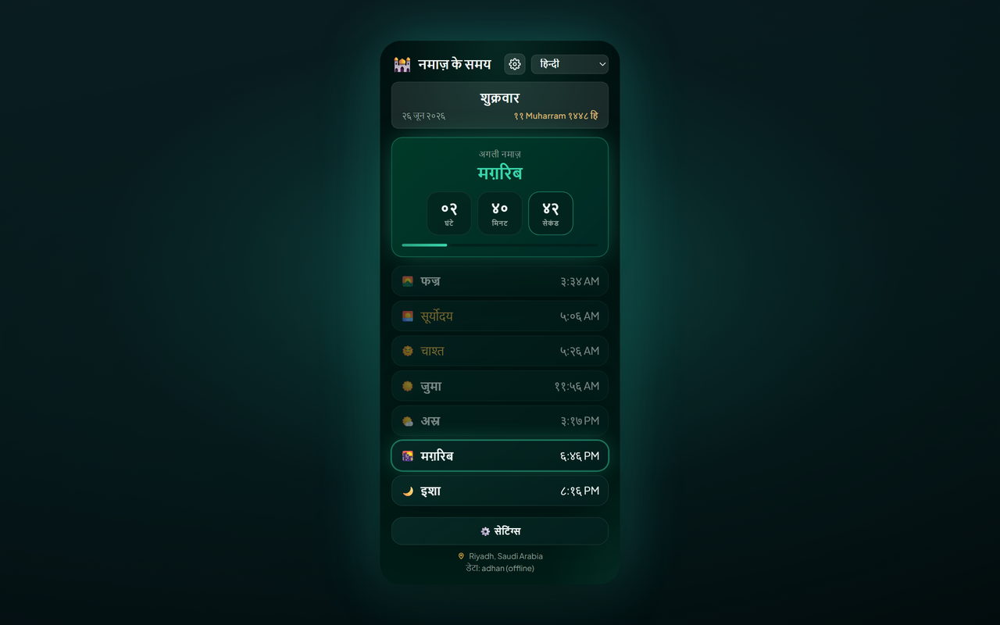

# Prayer Times Reminder — Chrome Extension (हिन्दी)

> **नमाज़ के समय का विराम** — नमाज़ का समय आने पर आपके खुले टैब लॉक हो जाते हैं ताकि आप स्क्रीन से हटकर नमाज़ पढ़ सकें।

A Manifest V3 Chrome extension that:

- 🔔 **हर नमाज़ के समय** (Fajr, Dhuhr, Asr, Maghrib, Isha) — आपकी चुनी हुई भाषा में नोटिफाई करता है।
- 🔒 **ऐच्छिक टैब लॉक** — समय आने पर **सभी खुले ब्राउज़र टैब्स** को (1–120 मिनट, डिफ़ॉल्ट 5) तक लॉक करता है, काउंटडाउन ओवरले के साथ; लॉक के दौरान आप जो टैब खोलते या नेविगेट करते हैं वे भी अपने-आप लॉक हो जाते हैं; लॉक स्क्रीन पर टैप करके जल्दी अनलॉक का विकल्प भी उपलब्ध। countdown के नीचे एक शांत पंक्ति: “विनम्रता और एकाग्रता के साथ अपनी नमाज़ की ओर ध्यान लगाएँ”।
- 🕌 **आपके शहर/देश के लिए पूरा दैनिक नमाज़ शेड्यूल** — अगली नमाज़ तक लाइव काउंटडाउन के साथ।
- 🌍 **Country & city dropdowns** — देश चुनें, फिर शहर की लिस्ट अपने-आप लोड हो जाएगी।
- 🌐 **11 भाषाएँ** — popup हेडर से या **Settings → Language** से स्विच करें (नीचे [Supported languages](#supported-languages))।
- 🌗 **Theme** — Midnight Emerald (डिफ़ॉल्ट) या Classic — Settings में चुनें।
- 📅 **Date format** — Hijri और Gregorian दोनों तारीख़ें कैसे दिखेंगी चुनें (जैसे `10-04-2026`, `10 April 2026`, लंबा टेक्स्ट)।
- 🌙 **Hijri date** — Gregorian तारीख़ के साथ दिखती है।
- 📿 **Periodic dhikr** — खुले टैब पर एक रैंडम धिक्र (151 वाक्य) फ़्लोट करता है; टैप करके बंद करें या 10 सेकंड बाद अपने-आप छिप जाएगा।
- 🎙️ **Prayer Adhkar game (ऐच्छिक)** — popup की Settings से अपने अलग टैब में खुलता है: हर नमाज़ के अज़कार ज़ोर से पढ़ें, Chrome की speech recognition साथ-साथ सुनती है, और आपको हर नमाज़, दिन और महीने के अंक मिलते हैं। बिना अकाउंट के खेल सकते हैं; ईमेल या Google साइन-इन सिर्फ़ leaderboard और दोस्तों को follow करने के लिए है। नमाज़ के समय के लिए कभी अकाउंट की ज़रूरत नहीं। लीडरबोर्ड की शुरुआत आयत ﴿وَفِي ذَٰلِكَ فَلْيَتَنَافَسِ الْمُتَنَافِسُونَ﴾ (सूरह अल-मुतफ़्फ़िफ़ीन, 83:26) से होती है, पहले अर्थ का अनुवाद और नीचे अरबी, और हर अवधि के ताज़ा विजेता प्रमुखता से दिखते हैं, पहला स्थान सुनहरे रंग में।
- 🌅 **सुबह और शाम के अज़कार** — गेम में नमाज़ के tasks के साथ दो रोज़ाना अतिरिक्त सेट: सुबह के अज़कार Fajr से Maghrib तक और शाम के अज़कार Maghrib से अगली Fajr तक (हर सेट में 13 अज़कार, किसी भी task की तरह ज़ोर से पढ़े जाते हैं, हर पूरे सेट पर 50 बोनस अंक)। एक ऐच्छिक हिस्सा, जो डिफ़ॉल्ट रूप से बंद है, ऐसे दो अज़कार जोड़ता है जिनकी प्रामाणिकता पर मतभेद है — हर एक के साथ उसका स्रोत और दर्जा — सिर्फ़ पढ़ने के लिए, बिना अंकों के।
- 🔗 **एक अकाउंट, कई साइन-इन तरीक़े** — गेम में **My account › Sign-in methods** के तहत आप अपने अकाउंट से Google लिंक कर सकते हैं (और Apple, जब Sign in with Apple चालू हो जाए) और दोनों में से किसी से भी साइन इन कर सकते हैं। Android पर, जिन खिलाड़ियों का ऐप Google Play Integrity पास करता है उन्हें leaderboard पर ✓ verified निशान मिलता है।
- 🗂️ **New tab (ऐच्छिक)** — Chrome का नया टैब एक घड़ी, अगली नमाज़ घंटे/मिनट/सेकंड में, आज के नमाज़ के समय, वेब सर्च, एक धिक्र और आपकी अज़कार प्रगति दिखाता है, ऐसे आसमान पर जो नमाज़ के समय के साथ बदलता है। इसे किसी भी ऐप में गेम के “My account” से बंद करें।

[English](README.en.md) · [Deutsch](README.de.md) · [العربية](README.ar.md) · [اردو](README.ur.md) · [Français](README.fr.md) · [Español](README.es.md) · [हिन्दी](README.hi.md) · [Bahasa Indonesia](README.id.md)

Prayer times are calculated offline on your device with [adhan-js](https://github.com/batoulapps/adhan-js) (the free [AlAdhan API](https://aladhan.com/prayer-times-api) is only a fallback for older saved locations without coordinates); the city list comes from the free [CountriesNow API](https://countriesnow.space). No API keys required.

## Other platforms

- **Website** — पूरा ऐप आपके ब्राउज़र में: https://mphpmaster.github.io/prayer-times-reminder-chrome-ext/app/
- **Android** — Google Play: https://play.google.com/store/apps/details?id=com.mphpmaster.prayer — होम-स्क्रीन widgets (अगली नमाज़, नमाज़ के समय, अज़कार प्रगति, काउंटडाउन) अगले Android अपडेट के साथ आएँगे।
- **Windows** — Microsoft Store: https://apps.microsoft.com/detail/9PFTWDWLNL7C, या नवीनतम [desktop release](https://github.com/mPhpMaster/prayer-times-reminder-chrome-ext/releases) से installer
- **iPhone / iPad** — जल्द आ रहा है; अभी App Store पर नहीं है। इसे source से build करें, या मुफ़्त unsigned build sideload करें: [targets/mobile/IOS.md](../targets/mobile/IOS.md)
- **Discord** — एक Vencord plugin; इंस्टॉल के चरण: [targets/vencord/README.md](../targets/vencord/README.md)

## Install

**Chrome Web Store से इंस्टॉल करें (अनुशंसित):** [Chrome में जोड़ें](https://chromewebstore.google.com/detail/prayer-times-reminder/knahkbkmbjghaiillhngjbhoinmeegoc)

या डेवलपमेंट के लिए इसे अनपैक्ड लोड करें:

1. Open `chrome://extensions` in Chrome.
2. Toggle **Developer mode** on (top-right).
3. Click **Load unpacked** and select this folder.
4. Click the extension icon in the toolbar to open the popup.
5. Click **⚙️ Settings**, choose your **Country** then **City** from the dropdowns (or click **📍 Use my location**), pick a calculation method, then **Save & Load**.
6. Choose your language from the **dropdown** in the popup header (or in **Settings → Language**).

पहली बार इंस्टॉल पर एक welcome tab खुलता है जिसमें Chrome toolbar पर **extension pin करने** के चरण होते हैं (Chrome extensions को खुद pin नहीं करने देता)।

बस — extension आज के समय लाएगा, दिखाएगा, और हर आने वाली नमाज़ के लिए notification शेड्यूल करेगा। आधी रात के बाद नए दिन के लिए अपने-आप refresh होता है।

> **Notifications:** सुनिश्चित करें कि OS settings में Chrome को system notifications दिखाने की अनुमति है, वरना alerts नहीं दिखेंगे।

## Settings

popup की Settings में ये विकल्प इस क्रम में चार कार्ड में बँटे हैं: **नमाज़ के समय** (देश, शहर, गणना पद्धति), **अलर्ट और लॉक** (टैब लॉक और उसके विकल्प), **तस्बीह और अनुस्मारक** (periodic dhikr), और **रूप-रंग** (थीम, भाषा, तारीख़ का फ़ॉर्मैट, अंकों की शैली)।

| Setting | Description |
|---------|-------------|
| Country / City | Location used for prayer times (or use geolocation). |
| Calculation method | AlAdhan method (ISNA, Muslim World League, Umm al-Qura, Egyptian, Karachi, Gulf, Diyanet, JAKIM, Kemenag, Moonsighting, etc.). |
| Lock tab during prayer | सभी खुले tabs पर prayer time के समय full-page overlay inject करता है। |
| Lock duration | Tab कितनी देर locked रहता है (1–120 minutes). |
| Allow manual unlock | Lock screen पर कहीं भी टैप करके (या Esc दबाकर) उसे जल्दी हटाने देता है। |
| Test tab lock | Current tab पर lock overlay preview (normal websites पर काम करता है, `chrome://` pages पर नहीं)। |
| Periodic dhikr | खुले टैब पर fixed या random interval (1–120 minutes) पर dhikr दिखाता है। |
| Dhikr position | Page का corner या center (top/bottom × left/right/center). |
| Test dhikr | Current tab पर dhikr card preview। |
| Theme | Midnight Emerald (default) या Classic. |
| Language | UI language (popup header में भी)। |
| Date format | Hijri और Gregorian दोनों तारीख़ें कैसे दिखती हैं। |
| Number style | When Arabic or Urdu is active: Arabic-Indic (٠١٢٣) or Western (0123) digits for times and countdowns. |

## Supported languages

The UI, notifications, lock overlay, dhikr card, and welcome page are localized. Change language from the popup header dropdown or **Settings → Language**.

| Code | Language | Direction | Notes |
|------|----------|-----------|-------|
| `en` | English | LTR | Default fallback if a string is missing |
| `de` | Deutsch (German) | LTR | |
| `ar` | العربية (Arabic) | RTL | Default on first install; optional Arabic-Indic numerals (٠١٢٣) |
| `ur` | اردو (Urdu) | RTL | Optional Arabic-Indic numerals (٠١٢٣) |
| `hi` | हिन्दी (Hindi) | LTR | |
| `id` | Bahasa Indonesia | LTR | |
| `fr` | Français (French) | LTR | |
| `es` | Español (Spanish) | LTR | |
| `ru` | Русский (Russian) | LTR | |
| `kk` | Қазақша (Kazakh) | LTR | Cyrillic script |
| `uz` | Oʻzbekcha (Uzbek) | LTR | Latin script |

Translations live in `i18n.js` (`I18N` + `SUPPORTED_LANGS`). Dhikr phrases in `tasbih-phrases.js` include Arabic with a translation per language (Hindi shows the English line; no Hindi translations yet).

## Files

| File | Purpose |
|------|---------|
| `manifest.json` | MV3 manifest (permissions: alarms, notifications, storage, geolocation, scripting, offscreen; optional `<all_urls>`). |
| `background.js` | Service worker — computes times, schedules `chrome.alarms`, fires localized notifications, locks all open tabs at prayer time. |
| `overlay-lock.js` | Injected overlay (shadow DOM) that blocks page interaction until the timer ends or the user unlocks manually. |
| `overlay-tasbih.js` | Injected floating dhikr card; dismiss on tap or after 10 seconds. |
| `tasbih-phrases.js` | 151 unique dhikr phrases. |
| `welcome.html` / `welcome.css` | First-install welcome page with pin-to-toolbar instructions (localized). |
| `i18n.js` | Shared translations (11 languages), prayer names, country list, calculation methods, date formats, digit helper. |
| `popup.html` / `popup.css` / `popup.js` | The popup UI (schedule, countdown, language selector, settings). |
| `theme.css` | Shared Midnight Emerald theme tokens and utilities (popup, settings, welcome). |
| `icons/` | Extension icons (crescent + star). |
| `scripts/make_icons.py` | Regenerates the PNG icons (dev-only, not needed at runtime). |
| `PRIVACY.md` | Privacy policy for the extension. |
| `TERMS.md` | Terms and conditions for the extension and companion apps. |

## How it works

- **Scheduling:** on install/startup and whenever your location changes, the service worker computes today's timings and creates one-shot `chrome.alarms` entries at each upcoming prayer time, plus a refresh alarm just after midnight.
- **Tab lock:** if enabled in settings, when a prayer alarm fires the extension injects `overlay-lock.js` into every open tab and shows a countdown overlay for the configured duration. The overlay blocks keyboard, scroll, and pointer input on the page. Tabs you open or navigate to during the lock window are locked automatically too. Enable **Allow manual unlock** to dismiss it early by tapping anywhere on it (or pressing Esc/Enter) — after a 2-second grace period, so a click already in progress can't dismiss it unseen. Use **Test tab lock** in settings to preview it on the current tab.
- **Dhikr reminder:** if enabled, a `chrome.alarms` timer shows a random phrase from `tasbih-phrases.js` on your open tabs at a fixed interval or a random interval within your min/max range. The card does not block the page; click it to dismiss or wait 10 seconds.
- **Notifications:** when a prayer time arrives, a localized system notification appears.
- **Popup:** renders the cached schedule instantly, then refreshes from the network; the next prayer is highlighted with a second-by-second countdown.

## Calculation methods

The settings dropdown exposes common AlAdhan methods — ISNA (North America), Muslim World League, Umm al-Qura (Makkah), Egyptian, Karachi, Gulf, Kuwait, Qatar, Singapore (MUIS), France, Diyanet (Turkey), Russia, Dubai, JAKIM (Malaysia), Kemenag (Indonesia), Morocco, Tunisia, Algeria, Jordan, and Moonsighting Committee Worldwide. Pick whichever matches your local mosque/authority for the most accurate times.

## Privacy

See [PRIVACY.md](../PRIVACY.md) for what data is stored locally and which third-party APIs are contacted.
See [TERMS.md](../TERMS.md) for the terms that apply to prayer-time calculations, the optional game, and game accounts.

## Support the project

ऐप मुफ़्त है — न विज्ञापन, न ट्रैकिंग। अगर आप इसे (और इसके गेम सर्वर को) चालू रखने में मदद करना चाहते हैं, तो [PayPal](https://paypal.me/mfsafadi) पर सहयोग कर सकते हैं। धन्यवाद! हर फ़ीचर हर हाल में मुफ़्त रहेगा।

## License

MIT — see [LICENSE](../LICENSE).

---

## सतत दान (सदक़ा जारिया) इनकी ओर से:
* ओम बिलाल - बाशिया हेजाज़ी
* अब्दुल्लाह अल-शामी
* ओम अब्दो स्रामिजो
* ओम फज्र जुनिर्ती
* सुहेरमन

और सभी जीवित और दिवंगत मुसलमानों की ओर से।

