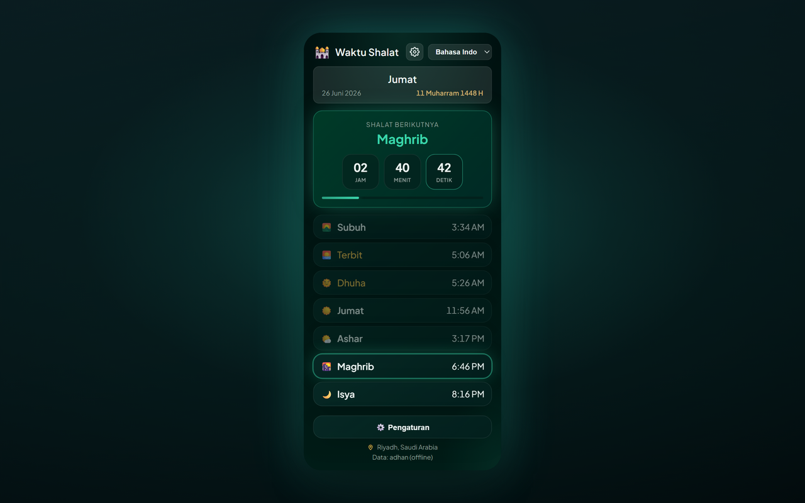

# Prayer Times Reminder — Chrome Extension (Bahasa Indonesia)

> **Jeda Waktu Shalat** — saat waktu shalat tiba, tab Anda yang terbuka terkunci agar Anda bisa menjauh dan shalat.

Ekstensi Chrome (Manifest V3) yang:

- 🔔 **Memberi notifikasi saat setiap waktu shalat tiba** (Fajr, Dhuhr, Asr, Maghrib, Isha) — dalam bahasa yang Anda pilih.
- 🔒 **Kunci tab opsional** — saat waktu shalat tiba, memblokir **semua tab browser yang terbuka** selama durasi yang dapat diatur (1–120 menit, default 5) dengan overlay hitung mundur; tab yang Anda buka atau kunjungi selama penguncian juga ikut terkunci; opsi buka kunci manual dengan mengetuk layar kunci. Di bawah hitung mundur ada kalimat yang menenangkan: “Hadapkan diri Anda pada salat dengan khusyuk”.
- 🕌 **Menampilkan jadwal shalat harian lengkap** untuk kota/negara Anda, dengan hitung mundur langsung ke shalat berikutnya.
- 🌍 **Dropdown negara & kota** — pilih negara, lalu daftar kota dimuat otomatis.
- 🌐 **11 bahasa** — ganti dari header popup atau **Settings → Language** (lihat [Supported languages](#supported-languages)).
- 🌗 **Tema** — Midnight Emerald (default) atau Classic — dapat dipilih di Pengaturan.
- 📅 **Format tanggal** — pilih cara tanggal Hijriah dan Gregorian ditampilkan (mis. `10-04-2026`, `10 April 2026`, teks panjang).
- 🌙 **Tanggal Hijriah** ditampilkan bersama tanggal Gregorian.
- 📿 **Dzikir berkala** — pengingat mengambang opsional dengan 151 frasa unik di tab-tab yang terbuka; ketuk untuk menutup atau hilang otomatis setelah 10 detik.
- 🎙️ **Permainan Dzikir Shalat (opsional)** — terbuka di tab tersendiri dari Pengaturan popup: bacakan dzikir setiap shalat dengan suara, pengenalan suara Chrome mengikuti bacaan Anda, dan Anda mendapat poin per shalat, hari, dan bulan. Bisa dimainkan tanpa akun; masuk dengan email atau Google hanya untuk papan peringkat dan mengikuti teman. Waktu shalat tidak pernah memerlukan akun. Papan peringkat dibuka dengan ayat ﴿وَفِي ذَٰلِكَ فَلْيَتَنَافَسِ الْمُتَنَافِسُونَ﴾ (QS. Al-Muthaffifin [83]: 26), terjemahan maknanya lebih dulu dan teks Arab di bawahnya, serta menonjolkan pemenang terbaru setiap periode, juara pertama berwarna emas.
- 🌅 **Dzikir pagi dan petang** — dua set harian tambahan di dalam permainan, di samping tugas shalat: dzikir pagi dari Fajr hingga Maghrib dan dzikir petang dari Maghrib hingga Fajr berikutnya (masing-masing 13 dzikir, dibaca dengan suara seperti tugas lainnya, 50 poin bonus per set lengkap). Bagian opsional, nonaktif secara default, menambahkan dua dzikir yang keshahihannya diperselisihkan, masing-masing dengan sumber dan derajatnya, hanya untuk dibaca dan tanpa poin.
- 🔗 **Satu akun, beberapa metode masuk** — di **My account › Sign-in methods** dalam permainan, Anda dapat menautkan Google ke akun Anda (dan Apple, setelah Sign in with Apple diaktifkan) lalu masuk dengan salah satunya. Di Android, pemain yang aplikasinya lolos Google Play Integrity mendapat tanda ✓ terverifikasi di papan peringkat.
- 🗂️ **Tab baru (opsional)** — tab baru Chrome menampilkan jam, shalat berikutnya dalam jam/menit/detik, waktu shalat hari ini, pencarian web, sebuah dzikir, dan kemajuan dzikir Anda, di atas langit yang mengikuti waktu shalat. Matikan dari “My account” di permainan, di aplikasi mana pun.

[English](README.en.md) · [Deutsch](README.de.md) · [العربية](README.ar.md) · [اردو](README.ur.md) · [Français](README.fr.md) · [Español](README.es.md) · [हिन्दी](README.hi.md) · [Bahasa Indonesia](README.id.md)

Waktu shalat dihitung secara offline di perangkat Anda dengan [adhan-js](https://github.com/batoulapps/adhan-js) ([AlAdhan API](https://aladhan.com/prayer-times-api) gratis hanya menjadi cadangan untuk lokasi lama yang tersimpan tanpa koordinat); daftar kota dari [CountriesNow API](https://countriesnow.space) gratis. Tidak perlu kunci API.

## Platform lain

- **Situs web** — seluruh aplikasi di browser Anda: https://mphpmaster.github.io/prayer-times-reminder-chrome-ext/app/
- **Android** — Google Play: https://play.google.com/store/apps/details?id=com.mphpmaster.prayer — widget layar utama (shalat berikutnya, waktu shalat, kemajuan dzikir, hitung mundur) hadir dengan pembaruan Android berikutnya.
- **Windows** — Microsoft Store: https://apps.microsoft.com/detail/9PFTWDWLNL7C, atau installer dari [rilis desktop](https://github.com/mPhpMaster/prayer-times-reminder-chrome-ext/releases) terbaru
- **iPhone / iPad** — segera hadir; belum ada di App Store. Bangun dari kode sumber, atau sideload build gratis yang tidak ditandatangani: [targets/mobile/IOS.md](../targets/mobile/IOS.md)
- **Discord** — plugin Vencord; langkah instalasi: [targets/vencord/README.md](../targets/vencord/README.md)

## Instalasi

**Pasang dari Chrome Web Store (disarankan):** [Tambahkan ke Chrome](https://chromewebstore.google.com/detail/prayer-times-reminder/knahkbkmbjghaiillhngjbhoinmeegoc)

Atau muat tanpa kemasan untuk pengembangan:

1. Buka `chrome://extensions` di Chrome.
2. Aktifkan **Developer mode** (kanan atas).
3. Klik **Load unpacked** dan pilih folder ini.
4. Klik ikon ekstensi di bilah alat untuk membuka popup.
5. Klik **⚙️ Settings**, pilih **Country** lalu **City** dari dropdown (atau klik **📍 Use my location**), pilih metode perhitungan, lalu **Save & Load**.
6. Pilih bahasa dari dropdown di header popup (atau di **Settings → Language**).

Saat instalasi pertama, tab selamat datang terbuka dengan langkah untuk **menyematkan ekstensi** ke bilah alat Chrome (Chrome tidak mengizinkan ekstensi menyematkan dirinya sendiri).

Selesai — ekstensi akan mengambil waktu hari ini, menampilkannya, dan menjadwalkan notifikasi untuk setiap shalat mendatang. Secara otomatis diperbarui setelah tengah malam untuk hari baru.

> **Notifikasi:** pastikan Chrome diizinkan menampilkan notifikasi sistem di pengaturan OS Anda, jika tidak peringatan tidak akan muncul.

## Pengaturan

Di pengaturan popup, opsi-opsi ini dikelompokkan dalam empat kartu, dengan urutan: **Waktu salat** (negara, kota, metode perhitungan), **Notifikasi & kunci** (kunci tab dan opsinya), **Tasbih & pengingat** (dzikir berkala), dan **Tampilan** (tema, bahasa, format tanggal, gaya angka).

| Setting | Description |
|---------|-------------|
| Country / City | Lokasi untuk waktu shalat (atau gunakan geolokasi). |
| Calculation method | Metode AlAdhan (ISNA, Muslim World League, Umm al-Qura, Egyptian, Karachi, Gulf, Diyanet, JAKIM, Kemenag, Moonsighting, dll.). |
| Lock tab during prayer | Menyuntikkan overlay layar penuh di semua tab yang terbuka saat waktu shalat. |
| Lock duration | Berapa lama tab tetap terkunci (1–120 menit). |
| Allow manual unlock | Memungkinkan menutup layar kunci lebih awal dengan mengetuk di mana saja (atau menekan Esc). |
| Test tab lock | Pratinjau overlay kunci di tab saat ini (berfungsi di situs normal, bukan halaman `chrome://`). |
| Periodic dhikr | Menampilkan dzikir acak di tab-tab yang terbuka pada interval tetap atau acak (1–120 menit). |
| Dhikr position | Sudut atau tengah halaman (atas/bawah × kiri/kanan/tengah). |
| Test dhikr | Pratinjau kartu dzikir di tab saat ini. |
| Theme | Pilih **Midnight Emerald** (default) atau **Classic**. |
| Language | Pilih bahasa UI (juga tersedia di header popup). |
| Date format | Cara tanggal Hijriah dan Gregorian ditampilkan. |
| Number style | Saat Arab atau Urdu aktif: angka Arabic-Indic (٠١٢٣) atau Barat (0123) untuk waktu dan hitung mundur. |

## Bahasa yang didukung

UI, notifikasi, overlay kunci, kartu dzikir, dan halaman selamat datang dilokalkan. Ganti bahasa dari dropdown header popup atau **Settings → Language**.

| Code | Language | Direction | Notes |
|------|----------|-----------|-------|
| `en` | English | LTR | Fallback default jika string hilang |
| `de` | Deutsch (German) | LTR | |
| `ar` | العربية (Arabic) | RTL | Default saat instal pertama; angka Arabic-Indic opsional (٠١٢٣) |
| `ur` | اردو (Urdu) | RTL | Angka Arabic-Indic opsional (٠١٢٣) |
| `hi` | हिन्दी (Hindi) | LTR | |
| `id` | Bahasa Indonesia | LTR | |
| `fr` | Français (French) | LTR | |
| `es` | Español (Spanish) | LTR | |
| `ru` | Русский (Russian) | LTR | |
| `kk` | Қазақша (Kazakh) | LTR | Aksara Kiril |
| `uz` | Oʻzbekcha (Uzbek) | LTR | Aksara Latin |

Terjemahan ada di `i18n.js` (`I18N` + `SUPPORTED_LANGS`). Frasa dzikir di `tasbih-phrases.js` mencakup teks Arab dengan terjemahan per bahasa (Hindi menampilkan baris bahasa Inggris; belum ada terjemahan Hindi).

## File

| File | Purpose |
|------|---------|
| `manifest.json` | Manifest MV3 (izin: alarms, notifications, storage, geolocation, scripting, offscreen; `<all_urls>` opsional). |
| `background.js` | Service worker — menghitung waktu, menjadwalkan `chrome.alarms`, mengirim notifikasi lokal, mengunci semua tab yang terbuka saat waktu shalat. |
| `overlay-lock.js` | Overlay disuntikkan (shadow DOM) yang memblokir interaksi halaman sampai timer selesai atau Anda buka kunci manual. |
| `overlay-tasbih.js` | Kartu dzikir mengambang disuntikkan; tutup dengan ketuk atau setelah 10 detik. |
| `tasbih-phrases.js` | 151 frasa dzikir unik. |
| `welcome.html` / `welcome.css` | Halaman selamat datang instalasi pertama dengan instruksi sematkan ke toolbar (lokal). |
| `i18n.js` | Terjemahan bersama (11 bahasa), nama shalat, daftar negara, metode perhitungan, format tanggal, helper digit. |
| `popup.html` / `popup.css` / `popup.js` | UI popup (jadwal, hitung mundur, pemilih bahasa, pengaturan). |
| `theme.css` | Token dan utilitas tema Midnight Emerald bersama (popup, pengaturan, selamat datang). |
| `icons/` | Ikon ekstensi (bulan sabit + bintang). |
| `scripts/make_icons.py` | Membuat ulang ikon PNG (dev-only, tidak diperlukan saat runtime). |
| `PRIVACY.md` | Kebijakan privasi ekstensi. |
| `TERMS.md` | Syarat dan ketentuan untuk ekstensi dan aplikasi pendampingnya. |

## Cara kerja

- **Penjadwalan:** saat instalasi/startup dan setiap kali lokasi berubah, service worker menghitung waktu hari ini dan membuat entri `chrome.alarms` sekali pakai pada setiap waktu shalat mendatang, plus alarm refresh tepat setelah tengah malam.
- **Kunci tab:** jika diaktifkan di pengaturan, saat alarm shalat berbunyi ekstensi menyuntikkan `overlay-lock.js` ke setiap tab yang terbuka dan menampilkan overlay hitung mundur selama durasi yang dikonfigurasi. Overlay memblokir keyboard, scroll, dan input pointer. Tab yang Anda buka atau kunjungi selama jendela penguncian juga ikut terkunci secara otomatis. Aktifkan **Allow manual unlock** untuk menutupnya lebih awal dengan mengetuk di mana saja (atau menekan Esc/Enter) — setelah jeda 2 detik, agar klik yang sedang berlangsung tidak menutupnya sebelum terlihat. Gunakan **Test tab lock** untuk pratinjau di tab saat ini.
- **Pengingat dzikir:** jika diaktifkan, timer `chrome.alarms` menampilkan frasa acak dari `tasbih-phrases.js` di tab-tab yang terbuka pada interval tetap atau acak dalam rentang min/max Anda. Kartu tidak memblokir halaman; ketuk untuk menutup atau tunggu 10 detik.
- **Notifikasi:** saat waktu shalat tiba, notifikasi sistem yang dilokalkan muncul.
- **Popup:** menampilkan jadwal cache secara instan, lalu memperbarui dari jaringan; shalat berikutnya disorot dengan hitung mundur per detik.

## Metode perhitungan

Dropdown pengaturan menampilkan metode AlAdhan umum — ISNA (Amerika Utara), Muslim World League, Umm al-Qura (Makkah), Egyptian, Karachi, Gulf, Kuwait, Qatar, Singapore (MUIS), France, Diyanet (Turki), Russia, Dubai, JAKIM (Malaysia), Kemenag (Indonesia), Morocco, Tunisia, Algeria, Jordan, dan Moonsighting Committee Worldwide. Pilih yang sesuai masjid/otoritas lokal Anda untuk waktu paling akurat.

## Privasi

Lihat [PRIVACY.md](../PRIVACY.md) untuk data yang disimpan secara lokal dan API pihak ketiga yang dihubungi.
Lihat [TERMS.md](../TERMS.md) untuk ketentuan yang berlaku pada perhitungan waktu shalat, permainan opsional, dan akun permainan.

## Dukung proyek ini

Aplikasi ini gratis, tanpa iklan dan tanpa pelacakan. Jika Anda ingin membantu agar aplikasi ini (dan server permainannya) tetap berjalan, Anda dapat mendukungnya melalui [PayPal](https://paypal.me/mfsafadi). Terima kasih! Semua fitur tetap gratis apa pun pilihan Anda.

## Lisensi

MIT — lihat [LICENSE](../LICENSE).

---

## Amal Jariyah (Sadaqah Jariyah) atas nama:
* Om Bilal - Bashia Hegazi
* Abdullah Al-Shami
* Om Abdo Sramijo
* Om Fajr Junirti
* Suherman

Dan atas nama seluruh umat Muslim, baik yang masih hidup maupun yang telah wafat.

