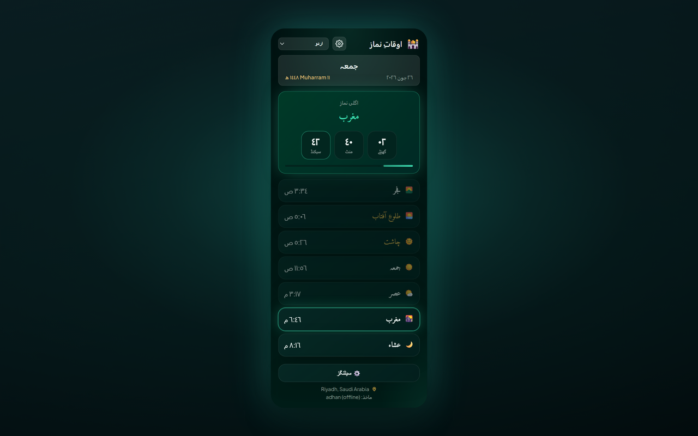

# Prayer Times Reminder — Chrome Extension (اردو)

> **اوقاتِ نماز کا وقفہ** — جب نماز کا وقت آتا ہے تو آپ کے کھلے ٹیبز لاک ہو جاتے ہیں تاکہ آپ اسکرین سے ہٹ کر نماز پڑھ سکیں۔

یہ Chrome (Manifest V3) ایکسٹینشن:

- 🔔 **ہر نماز کے وقت پر** نوٹیفکیشن بھیجتی ہے (Fajr, Dhuhr, Asr, Maghrib, Isha) — آپ کی منتخب کردہ زبان میں۔
- 🔒 **اختیاری ٹیب لاک** — جب نماز کا وقت آئے تو ایک قابلِ ترتیب مدت (1–120 منٹ، ڈیفالٹ 5) کے لیے **تمام کھلے براؤزر ٹیبز** کو بلاک کرتی ہے، ساتھ ہی کاؤنٹ ڈاؤن اوورلے بھی ہوتا ہے؛ لاک کے دوران آپ جو ٹیبز کھولیں یا جن پر جائیں وہ بھی خودکار طور پر کور ہو جاتے ہیں؛ لاک اسکرین پر ٹیپ کر کے دستی ان لاک کا اختیاری آپشن۔
- 🕌 **روزانہ نمازوں کا مکمل شیڈول** آپ کے شہر/ملک کے لیے دکھاتی ہے، اور اگلی نماز تک لائیو کاؤنٹ ڈاؤن کرتی ہے۔
- 🌍 **ملک اور شہر کے ڈراپ ڈاؤن** — ملک منتخب کریں، تو شہر کی فہرست خودکار طور پر لوڈ ہو جاتی ہے۔
- 🌐 **11 زبانیں** — پاپ اپ (popup) ہیڈر سے یا **Settings → Language** سے سوئچ کریں (دیکھیں [Supported languages](#supported-languages))۔
- 🌗 **تھیم (Theme)** — Midnight Emerald (ڈیفالٹ) یا Classic؛ سیٹنگز (Settings) میں منتخب کیا جا سکتا ہے۔
- 📅 **تاریخ کا فارمیٹ (Date format)** — ہجری (Hijri) اور عیسوی (Gregorian) دونوں تاریخیں کس طرح دکھانی ہیں منتخب کریں (مثلاً &lrm;`10-04-2026`، &lrm;`10 April 2026`، طویل متن)۔
- 🌙 **ہجری تاریخ (Hijri date)** — عیسوی (Gregorian) تاریخ کے ساتھ دکھائی جاتی ہے۔
- 📿 **وقفے وقفے سے ذکر (Periodic dhikr)** — اختیاری فلوٹنگ ریمائنڈر جس میں کھلے ٹیبز پر 151 منفرد جملے ہوتے ہیں؛ چھپانے کے لیے دبائیں یا 10 سیکنڈ بعد خودکار طور پر ہٹ جائے گا۔
- 🎙️ **نماز کے اذکار کا گیم (Prayer Adhkar game، اختیاری)** — پاپ اپ (popup) کی Settings سے اپنے الگ ٹیب میں کھلتا ہے: ہر نماز کے اذکار بلند آواز سے پڑھیں، Chrome کی speech recognition ساتھ ساتھ سنتی ہے، اور آپ کو ہر نماز، دن اور مہینے کے پوائنٹس ملتے ہیں۔ اکاؤنٹ کے بغیر کھیلا جا سکتا ہے؛ ای میل یا Google سائن اِن صرف لیڈر بورڈ اور دوستوں کو فالو کرنے کے لیے ہے۔ نماز کے اوقات کے لیے کبھی اکاؤنٹ کی ضرورت نہیں۔
- 🌅 **صبح و شام کے اذکار** — گیم میں نماز کے ٹاسکس کے ساتھ دو روزانہ اضافی سیٹ: صبح کے اذکار Fajr سے Maghrib تک اور شام کے اذکار Maghrib سے اگلی Fajr تک (ہر سیٹ میں 13 اذکار، کسی بھی ٹاسک کی طرح بلند آواز سے پڑھے جاتے ہیں، ہر مکمل سیٹ پر 50 بونس پوائنٹس)۔ ایک اختیاری حصہ، جو ڈیفالٹ طور پر بند ہے، دو ایسے اذکار شامل کرتا ہے جن کی صحت میں اختلاف ہے، ہر ایک اپنے ماخذ اور درجے کے ساتھ، صرف پڑھنے کے لیے اور بغیر پوائنٹس کے۔
- 🔗 **ایک اکاؤنٹ، سائن اِن کے کئی طریقے** — گیم میں **My account › Sign-in methods** کے تحت آپ اپنے اکاؤنٹ سے Google لنک کر سکتے ہیں (اور Apple، جب Sign in with Apple آن ہو جائے) اور دونوں میں سے کسی سے بھی سائن اِن کر سکتے ہیں۔ اینڈرائیڈ (Android) پر، جن کھلاڑیوں کی ایپ Google Play Integrity پاس کرتی ہے انہیں لیڈر بورڈ پر ✓ تصدیق شدہ نشان ملتا ہے۔
- 🗂️ **نیا ٹیب (New tab، اختیاری)** — Chrome کا نیا ٹیب ایک گھڑی، اگلی نماز گھنٹوں/منٹوں/سیکنڈوں میں، آج کے نماز کے اوقات، ویب سرچ، ایک dhikr اور آپ کے اذکار کی پیش رفت دکھاتا ہے، ایک ایسے آسمان پر جو نماز کے اوقات کے ساتھ بدلتا ہے۔ اسے کسی بھی ایپ میں گیم کے **My account** سے بند کریں۔

[English](README.en.md) · [Deutsch](README.de.md) · [العربية](README.ar.md) &lrm;· [اردو](README.ur.md) · [Français](README.fr.md) · [Español](README.es.md) · [हिन्दी](README.hi.md) · [Bahasa Indonesia](README.id.md)

نمازوں کے اوقات آپ کے آلے پر [adhan-js](https://github.com/batoulapps/adhan-js) کے ذریعے آف لائن حساب کیے جاتے ہیں (مفت [AlAdhan API](https://aladhan.com/prayer-times-api) صرف بغیر کوآرڈینیٹس کے محفوظ پرانے مقامات کے لیے بیک اپ ہے)؛ شہر کی فہرست مفت [CountriesNow API](https://countriesnow.space) سے آتی ہے۔ کوئی API کیز درکار نہیں۔

## Other platforms

- **ویب سائٹ (Website)** — پوری ایپ آپ کے براؤزر میں: [ویب ایپ کھولیں](https://mphpmaster.github.io/prayer-times-reminder-chrome-ext/app/)
- **اینڈرائیڈ (Android)** — گوگل پلے: [Google Play پر کھولیں](https://play.google.com/store/apps/details?id=com.mphpmaster.prayer) — ہوم اسکرین ویجیٹس (اگلی نماز، نماز کے اوقات، اذکار کی پیش رفت، کاؤنٹ ڈاؤن) اگلی Android اپڈیٹ کے ساتھ آئیں گے۔
- **ونڈوز (Windows)** — مائیکروسافٹ اسٹور: [Microsoft Store پر کھولیں](https://apps.microsoft.com/detail/9PFTWDWLNL7C)، یا تازہ ترین [ڈیسک ٹاپ ریلیز](https://github.com/mPhpMaster/prayer-times-reminder-chrome-ext/releases) سے انسٹالر
- **آئی فون / آئی پیڈ (iPhone / iPad)** — جلد آ رہا ہے؛ ابھی App Store پر نہیں ہے۔ اسے سورس سے بنائیں، یا مفت unsigned build کو sideload کریں: [targets/mobile/IOS.md](../targets/mobile/IOS.md)
- **ڈسکارڈ (Discord)** — ایک Vencord پلگ اِن؛ انسٹال کے مراحل: [targets/vencord/README.md](../targets/vencord/README.md)

## انسٹال

**کروم ویب اسٹور (Chrome Web Store) سے انسٹال کریں (تجویز کردہ):** [Chrome میں شامل کریں](https://chromewebstore.google.com/detail/prayer-times-reminder/knahkbkmbjghaiillhngjbhoinmeegoc)

یا ڈیولپمنٹ کے لیے اسے ان پیکڈ لوڈ کریں:

1. کروم (Chrome) میں `chrome://extensions` کھولیں۔
2. اوپر دائیں طرف **Developer mode** آن کریں۔
3. اب **Load unpacked** پر کلک کریں اور یہ فولڈر منتخب کریں۔
4. ٹول بار میں ایکسٹینشن آئیکن پر کلک کر کے popup کھولیں۔
5. سیٹنگز (**⚙️ Settings**) پر کلک کریں، ڈراپ ڈاؤن سے اپنا ملک (**Country**) اور پھر شہر (**City**) منتخب کریں (یا **📍 Use my location** پر کلک کریں)، حساب کا طریقہ منتخب کریں، پھر **Save & Load** کریں۔
6. پاپ اپ (popup) ہیڈر کے ڈراپ ڈاؤن سے اپنی زبان منتخب کریں (یا **Settings → Language** میں)۔

پہلی بار انسٹال کے بعد، ایک خوش آمدید ٹیب کھلے گا جس میں Chrome ٹول بار میں ایکسٹینشن کو **pin** کرنے کے مراحل ہوں گے (Chrome خود بخود ایکسٹینشن کو pin نہیں کرنے دیتا)۔

یہی ہے — ایکسٹینشن آج کے اوقات لے کر دکھائے گی اور ہر اگلی نماز کے لیے نوٹیفکیشن شیڈول کرے گی۔ نئے دن کے لیے یہ آدھی رات کے بعد خودکار طور پر تازہ ہو جاتی ہے۔

> **نوٹیفکیشنز (Notifications):** اپنے OS سیٹنگز میں یقینی بنائیں کہ Chrome کو سسٹم نوٹیفکیشن دکھانے کی اجازت ہے، ورنہ الرٹس نظر نہیں آئیں گے۔

## Settings

| سیٹنگ (Setting) | تفصیل (Description) |
|---------|-------------|
| ملک / شہر Country / City | نمازوں کے لیے استعمال ہونے والا مقام (یا geolocation استعمال کریں)۔ |
| حساب کا طریقہ Calculation method | حساب کا AlAdhan طریقہ: ISNA, Muslim World League, Umm al-Qura, Egyptian, Karachi, Gulf, Diyanet, JAKIM, Kemenag, Moonsighting، وغیرہ۔ |
| تاریخ کا فارمیٹ Date format | ہجری (Hijri) اور عیسوی (Gregorian) دونوں تاریخیں کس طرح دکھائی جاتی ہیں۔ |
| اعداد کا انداز Number style | جب Arabic یا Urdu فعال ہو: Arabic-Indic (٠١٢٣) یا Western (0123) اعداد اوقات اور کاؤنٹ ڈاؤن کے لیے۔ |
| نماز کے دوران ٹیب لاک Lock tab during prayer | نماز کے وقت تمام کھلے ٹیبز پر مکمل صفحہ اوورلے ڈالتی ہے۔ |
| لاک کی مدت Lock duration | ٹیب کتنی دیر لاک رہے گا (1–120 منٹ)۔ |
| دستی ان لاک کی اجازت Allow manual unlock | لاک اسکرین پر کہیں بھی ٹیپ کر کے (یا Esc دبا کر) اسے جلدی ختم کرنے دیتی ہے۔ |
| ٹیب لاک آزمائیں Test tab lock | موجودہ ٹیب پر لاک اوورلے کی پیش نظارہ (عام ویب سائٹس پر کام کرتا ہے، `chrome://extensions` جیسے صفحات پر نہیں)۔ |
| وقفے وقفے سے ذکر Periodic dhikr | کھلے ٹیبز پر مقررہ یا بے ترتیب وقفے پر (1–120 منٹ) ایک رینڈم dhikr دکھاتی ہے۔ |
| ذکر کی جگہ Dhikr position | صفحے کا کونہ یا درمیان (اوپر/نیچے × بائیں/دائیں/درمیان)۔ |
| ذکر آزمائیں Test dhikr | موجودہ ٹیب پر dhikr کارڈ کا پری ویو۔ |
| تھیم Theme | تھیم منتخب کریں: **Midnight Emerald** (ڈیفالٹ) یا **Classic**۔ |
| زبان Language | یوزر انٹرفیس (UI) کی زبان منتخب کریں (یہ popup ہیڈر میں بھی موجود ہے)۔ |

## Supported languages

یوزر انٹرفیس (UI)، نوٹیفکیشنز، لاک اوورلے، dhikr کارڈ، اور خوش آمدید پیج لوکلائز کیے گئے ہیں۔ زبان تبدیل کرنے کے لیے popup ہیڈر کے ڈراپ ڈاؤن یا **Settings → Language** استعمال کریں۔

| کوڈ (Code) | زبان (Language) | سمت (Direction) | نوٹس (Notes) |
|------|----------|-----------|-------|
| `en` | English | LTR | اگر کسی متن کی کمی ہو تو ڈیفالٹ فال بیک |
| `de` | Deutsch (German) | LTR | |
| `ar` | العربية (Arabic) | RTL | پہلی بار انسٹال پر ڈیفالٹ؛ اختیاری Arabic-Indic numerals (٠١٢٣) |
| `ur` | اردو (Urdu) | RTL | اختیاری Arabic-Indic numerals (٠١٢٣) |
| `hi` | हिन्दी (Hindi) | LTR | |
| `id` | Bahasa Indonesia | LTR | |
| `fr` | Français (French) | LTR | |
| `es` | Español (Spanish) | LTR | |
| `ru` | Русский (Russian) | LTR | |
| `kk` | Қазақша (Kazakh) | LTR | سیریلک رسم الخط |
| `uz` | Oʻzbekcha (Uzbek) | LTR | لاطینی رسم الخط |

ترجمے `i18n.js` میں ہیں (`I18N` اور `SUPPORTED_LANGS`)۔ فائل `tasbih-phrases.js` میں dhikr جملے عربی متن کے ساتھ ہر زبان کا ترجمہ رکھتے ہیں (Hindi میں انگریزی سطر دکھائی جاتی ہے؛ ابھی Hindi ترجمے موجود نہیں)۔

## Files

| فائل (File) | مقصد (Purpose) |
|---------|-------------|
| `manifest.json` | مینِفیسٹ (MV3) — permissions: alarms, notifications, storage, geolocation, scripting, offscreen؛ اختیاری &lrm;`<all_urls>`&lrm;۔ |
| `background.js` | سروس ورکر — اوقات کا حساب لگاتا ہے، `chrome.alarms` شیڈول کرتا ہے، لوکلائز نوٹیفکیشن دکھاتا ہے، اور نماز کے وقت تمام کھلے ٹیبز لاک کرتا ہے۔ |
| `overlay-lock.js` | انجیکٹ کیا گیا اوورلے (shadow DOM) جو ٹائمر ختم ہونے تک یا صارف کے دستی ان لاک تک صفحے کی انٹر ایکشن روک دے۔ |
| `overlay-tasbih.js` | انجیکٹ کیا گیا فلوٹنگ dhikr کارڈ؛ دبانے پر یا 10 سیکنڈ بعد غائب۔ |
| `tasbih-phrases.js` | 151 منفرد dhikr فقرے۔ |
| `welcome.html` / `welcome.css` | پہلی بار انسٹال کے لیے خوش آمدید صفحہ، pin-to-toolbar ہدایات کے ساتھ (لوکلائز)۔ |
| `i18n.js` | مشترکہ ترجمے (11 زبانیں)، نمازوں کے نام، ملکوں کی فہرست، حساب کے طریقے، تاریخ کی فارمیٹس، اور اعداد کا مددگار۔ |
| `popup.html` / `popup.css` / `popup.js` | پاپ اپ کا UI (شیڈول، کاؤنٹ ڈاؤن، زبان کا انتخاب، سیٹنگز)۔ |
| `theme.css` | مشترکہ Midnight Emerald تھیم ٹوکنز اور یوٹیلیٹیز (popup، سیٹنگز، خوش آمدید صفحہ)۔ |
| `icons/`&lrm; | ایکسٹینشن آئیکنز (ہلال + ستارہ)۔ |
| `scripts/make_icons.py` | آئیکنز کی PNG فائلیں دوبارہ بناتا ہے (صرف dev کے لیے؛ runtime میں ضروری نہیں)۔ |
| `PRIVACY.md` | ایکسٹینشن کی پرائیویسی پالیسی۔ |
| `TERMS.md` | ایکسٹینشن اور ساتھی ایپس کے لیے شرائط و ضوابط۔ |

## How it works

- **شیڈولنگ (Scheduling):** انسٹال/اسٹارٹ اپ پر اور جب بھی لوکیشن تبدیل ہو، service worker آج کے timings کا حساب لگاتا ہے اور ہر آنے والی نماز کے وقت پر `chrome.alarms` کے ایک شاٹ اندراجات بناتا ہے، ساتھ ہی آدھی رات کے فوراً بعد refresh alarm بھی۔
- **ٹیب لاک (Tab lock):** اگر settings میں فعال ہو تو، جب نماز کا الارم بجتا ہے تو ایکسٹینشن ہر کھلے ٹیب میں `overlay-lock.js` inject کرتی ہے اور مقررہ مدت کے لیے کاؤنٹ ڈاؤن اوورلے دکھاتی ہے۔ یہ اوورلے صفحے پر کی بورڈ، اسکرول اور pointer input کو بلاک کرتا ہے۔ لاک کے دورانیے میں آپ جو ٹیبز کھولیں یا جن پر جائیں وہ بھی خودکار طور پر لاک ہو جاتے ہیں۔ **Allow manual unlock** کو فعال کریں تاکہ اسے کہیں بھی ٹیپ کر کے (یا Esc/Enter دبا کر) جلدی ختم کیا جا سکے — 2 سیکنڈ کی مہلت کے بعد، تاکہ پہلے سے جاری کلک اسے دیکھے بغیر بند نہ کر دے۔ موجودہ ٹیب پر پیش نظارہ کے لیے settings میں **Test tab lock** استعمال کریں۔
- **ذکر کی یاد دہانی (Dhikr reminder):** اگر فعال ہو تو، `chrome.alarms` ٹائمر `tasbih-phrases.js` سے ایک رینڈم جملہ کھلے ٹیبز پر مقررہ وقفے یا min/max رینج کے اندر بے ترتیب وقفے پر دکھاتا ہے۔ کارڈ صفحہ بلاک نہیں کرتا؛ چھپانے کے لیے دبائیں یا 10 سیکنڈ انتظار کریں۔
- **نوٹیفکیشنز (Notifications):** جب نماز کا وقت آتا ہے تو ایک لوکلائزڈ سسٹم نوٹیفکیشن ظاہر ہوتا ہے۔
- **پاپ اپ (Popup):** محفوظ کردہ شیڈول فوراً رینڈر ہوتا ہے، پھر نیٹ ورک سے ریفریش ہوتا ہے؛ اگلی نماز کو سیکنڈ بہ سیکنڈ کاؤنٹ ڈاؤن کے ساتھ نمایاں کیا جاتا ہے۔

## Calculation methods

سیٹنگز (Settings) کا ڈراپ ڈاؤن عام AlAdhan طریقے دکھاتا ہے — ISNA (شمالی امریکہ)، Muslim World League، Umm al-Qura (مکہ مکرمہ)، Egyptian، Karachi، Gulf، Kuwait، Qatar، Singapore (MUIS)، France، Diyanet (ترکی)، Russia، Dubai، JAKIM (ملائیشیا)، Kemenag (انڈونیشیا)، Morocco، Tunisia، Algeria، Jordan، اور Moonsighting Committee Worldwide۔ اپنے مقامی مسجد/ادارے کے مطابق جو بہتر لگے وہ منتخب کریں تاکہ اوقات زیادہ درست ہوں۔

## Privacy

کون سا ڈیٹا لوکل طور پر محفوظ ہوتا ہے اور کن تھرڈ پارٹی API کو رابطہ کیا جاتا ہے، اس کے لیے [PRIVACY.md](../PRIVACY.md) دیکھیں۔
نماز کے اوقات کے حساب، اختیاری گیم، اور گیم اکاؤنٹس پر لاگو شرائط کے لیے [TERMS.md](../TERMS.md) دیکھیں۔

## Support the project

ایپ مفت ہے، نہ اشتہارات اور نہ ٹریکنگ۔ اگر آپ اسے (اور اس کے گیم سرور کو) چلتا رکھنے میں مدد کرنا چاہیں تو [PayPal](https://paypal.me/mfsafadi) پر اس کی معاونت کر سکتے ہیں۔ شکریہ! ہر فیچر ہر صورت میں مفت رہے گا۔

## License

لائسنس MIT ہے — [LICENSE](../LICENSE) دیکھیں۔

---

## صدقہ جاریہ منجانب:
* ام بلال - باشية حجازي
* عبداللہ الشامی
* ام عبدو صراميجو
* أم فجر جونيرتي
* سوهيرمان

اور تمام مسلمان زندوں اور مردوں کی طرف سے۔

